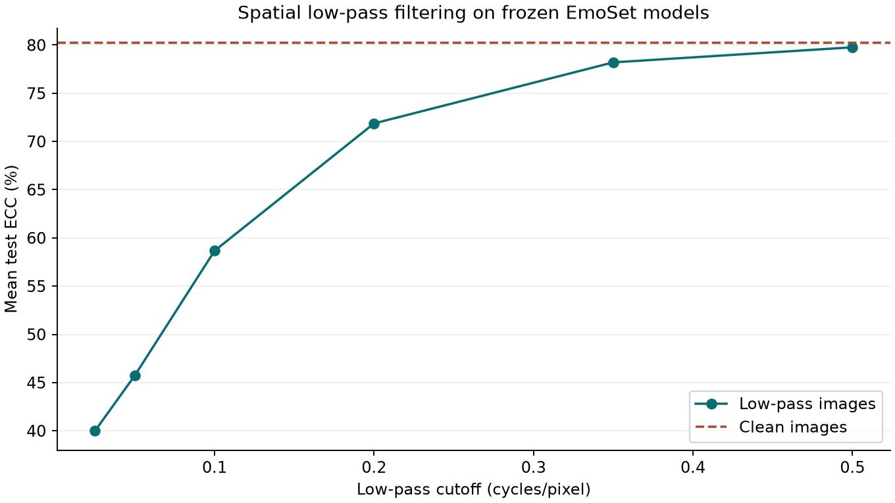
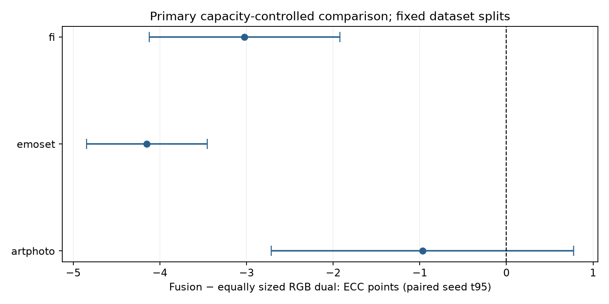

# To Err Like Human · Haar Wavelet Study

This project studies how image frequencies affect visual emotion recognition. The baseline predicts one of eight emotions that a photograph can evoke. Exact-label accuracy counts correct predictions. **Emotion Confusion Confidence (ECC)** also gives partial credit when the prediction is emotionally close to the reference label. **Emotional Misclassification Confidence (EMC)** measures closeness among the mistakes.

The signal-processing experiments start with a spatial FFT low-pass sweep, then test how a two-level Haar filter bank separates coarse structure from signed detail. The final comparison feeds those components to two independent branches and compares them against an equal-capacity model whose two branches both receive RGB.

## Repository structure

| Path | What lives here |
|---|---|
| [`src/ecc/`](src/ecc/) | Reusable Python package. [Emotion costs and ordering](src/ecc/emotion.py), [metrics](src/ecc/metrics.py), and [ranking loss](src/ecc/losses.py) define how the project trains and scores predictions. [Supervised](src/ecc/supervised.py), [semi-supervised](src/ecc/ssl.py), and [evaluation](src/ecc/evaluate.py) modules implement the baseline entry points. |
| [`src/ecc/spatial_frequency.py`](src/ecc/spatial_frequency.py) | Two-dimensional FFT filtering on the pixel grid. The low-pass path multiplies each channel’s spectrum by a radial Butterworth response and transforms it back to pixels. |
| [`src/ecc/wavelets.py`](src/ecc/wavelets.py) | Orthonormal Haar analysis and synthesis, multilevel decomposition, coarse and signed-detail reconstruction, and the matched recognition models. |
| [`configs/`](configs/) | YAML configurations for data paths, optimization, model settings, and the primary wavelet comparison. Use [`wavelet_study.yaml`](configs/wavelet_study.yaml) to see the dataset split paths, methods, seeds, and training budget. |
| [`scripts/`](scripts/) | Experiment entry points. [Haar diagnostics](scripts/run_wavelet_sp_checks.py) verify tone response, alias cancellation, and grid averaging. [Wavelet training](scripts/run_wavelet_study.py) fits the paired classifiers, and the [spatial-frequency runner](scripts/run_fft_lowpass.py) evaluates archived checkpoints on filtered inputs. |
| [`tests/`](tests/) | Checks for metric and loss behavior, transform identities, and training and checkpoint workflows. |
| [`docs/wavelet_study/`](docs/wavelet_study/) | The [training protocol](docs/wavelet_study/STUDY_PLAN.md), [signal-processing derivations](docs/wavelet_study/SIGNAL_PROCESSING.md), [filter measurements](docs/wavelet_study/wavelet_sp_experiments.md), and [recognition findings](results/wavelet/summary.csv). |
| [`results/`](results/) | Saved FI, spatial FFT, and wavelet measurements with plots, seed tables, and input fingerprints. |
| [`pyproject.toml`](pyproject.toml) | Package dependencies, command-line entry points, and test discovery settings. |
| `data/`, `runs/`, `outputs/`, `work/` | Local datasets, checkpoints, generated outputs, and temporary files. These directories are Git-ignored. |

## Results and plots

### 1. FI baseline reproduction

| Historical FI run | Accuracy | ECC | EMC |
|---|---:|---:|---:|
| Supervised cross-entropy | 62.47% | 73.42% | 48.39% |
| Cross-entropy + ListMLE (α = 0.2) | 62.09% | 74.39% | 55.92% |
| Fixed threshold, 800 labels | 38.94% | 56.14% | 46.01% |
| EMC-adaptive threshold, 800 labels | 34.11% | 53.28% | 48.43% |

These are descriptive single runs. The ranking loss produced closer mistakes on average. In the 800-label run, the fixed threshold scored higher on accuracy and ECC.

### 2. Spatial FFT low-pass filtering

The same three frozen cross-entropy models evaluated **17,715 full EmoSet test photos**. Mean ECC was about **80.2%** on clean inputs, **45.74%** at a cutoff of **0.05 cycles/pixel**, and **71.87%** at **0.20 cycles/pixel**. Lower cutoffs suppress more fine detail. [Full sweep and conditions](results/README.md) · [Results table](results/fft/summary.csv)



### 3. Haar filter-bank diagnostics

The Haar transform splits squared signal energy among its bands. Across 99 controlled tone cases the measured energy fractions matched theory to floating-point precision. The two reconstructed paths contributed opposite signs at the folded FFT bin and canceled when added. Averaging the 16 possible 4 × 4 grid alignments reduced measured shift error to **0%** for the tested one-pixel circular shift across **534** FI, EmoSet, and ArtPhoto crops. These measurements describe filtering, and use the [saved diagnostics](results/wavelet/wavelet_sp_results.json).


### 4. Matched-capacity Haar recognition

The primary comparison pairs eight training seeds per dataset and gives both models the same parameter count. The table uses mean held-out ECC.

| Dataset | RGB + RGB | Coarse + detail | Haar − RGB | Paired 95% interval |
|---|---:|---:|---:|---:|
| FI | 66.33% | 63.31% | −3.02 points | [−4.12, −1.92] |
| EmoSet subset | 73.10% | 68.95% | −4.15 points | [−4.85, −3.45] |
| ArtPhoto | 51.62% | 50.66% | −0.97 points | [−2.71, +0.78] |

The fixed Haar split scored lower on FI and the EmoSet subset. ArtPhoto’s paired interval includes zero. The recognition experiment used the original fixed grid. The 16-grid average was evaluated in the filter diagnostics above. [Per-seed results](results/wavelet/seed_results.csv) · [Paired effects](results/wavelet/summary.csv)



## Quick start

Create a Python environment, activate it, then run these commands from this folder. Install a matching CUDA-enabled PyTorch and torchvision build in that environment for GPU experiments.

```console
python -m pip install -e ".[dev]"
python -m pytest -q
python scripts/run_wavelet_sp_checks.py --synthetic-only --output runs/haar_demo
```

The last command verifies the 99 tone cases, folded FFT-bin cancellation, and the grid-averaged FIR identity on CPU with synthetic inputs.

## Reproduce the presentation experiments

### 1. Reproduce the four historical FI comparisons

With labeled images organized by class, create splits with `ecc-splits --root data/FI --out data/FI_splits` if you have no existing manifests. Preserve your recorded split when reproducing the historical table. The config paths can also point to the prepared image root and manifests in another checkout.

```console
ecc-train --config configs/fi_resnet50.yaml --set loss.alpha=0.0 output_dir=runs/fi_ce
ecc-train --config configs/fi_resnet50.yaml --set loss.alpha=0.2 output_dir=runs/fi_rank
ecc-ssl --config configs/ssl_fi.yaml --set ssl.rule=fixed output_dir=runs/fi_fixed
ecc-ssl --config configs/ssl_fi.yaml --set ssl.rule=ratio output_dir=runs/fi_emc
```

These were historical single runs. The paper's human-preference study and S²-VER results are cited in the slides.

### 2. Reproduce the FFT low-pass curve

Prepare a directory with `classes.txt`, `test.csv`, and the 192 × 192 RGB source images. Pass the three archived CE `best.pt` files. The runner follows the original 160 × 160 center crop, applies the order-2 filter per RGB channel, clips reconstructed pixel values to [0, 255], and evaluates the same checkpoints on all seven input conditions. `--limit 32 --device cpu` is a quick input check using the first 32 manifest rows.

```console
python scripts/run_fft_lowpass.py --dataset data/emoset_full --checkpoints checkpoints/ce_seed0/best.pt checkpoints/ce_seed1/best.pt checkpoints/ce_seed2/best.pt --out runs/fft_lowpass
python scripts/plot_fft_ecc.py --input runs/fft_lowpass/results.json
```

The original checkpoint and test manifest hashes are in [FFT fingerprints](results/fft/input_fingerprints.json).

### 3. Reproduce the Haar diagnostics and paired training

Copy [the wavelet config](configs/wavelet_study.yaml) to `local/wavelet.yaml` and set its three dataset paths. Absolute paths can reuse prepared datasets in the original checkout. Each dataset directory contains its own `classes.txt`, `train.csv`, `val.csv`, and `test.csv`. A split CSV has `path,label` columns, with image paths relative to its dataset directory.

```console
python scripts/run_wavelet_sp_checks.py --config local/wavelet.yaml --output runs/haar_checks
python scripts/run_wavelet_study.py --config local/wavelet.yaml --out runs/wavelet --device cuda
```

Haar diagnostics perform no training. The real-crop run uses the fixed test rows selected per class by the recorded seed. The training entry point runs the **48 fits in the reported comparison** (two methods × eight seeds × three datasets), selecting the best clean validation ECC before evaluating test. It verifies completed checkpoint identities on retry. A partial fit restarts from its recorded initialization. `--stage train` followed by `--stage evaluate` separates fitting from held-out evaluation. [Dataset and checkpoint locations](docs/DATA.md) · [Theory and protocol](docs/wavelet_study/SIGNAL_PROCESSING.md)
