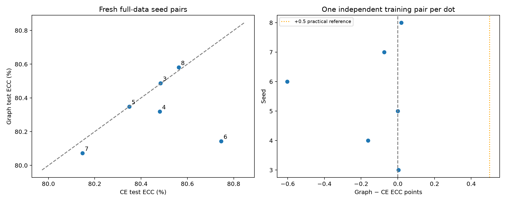
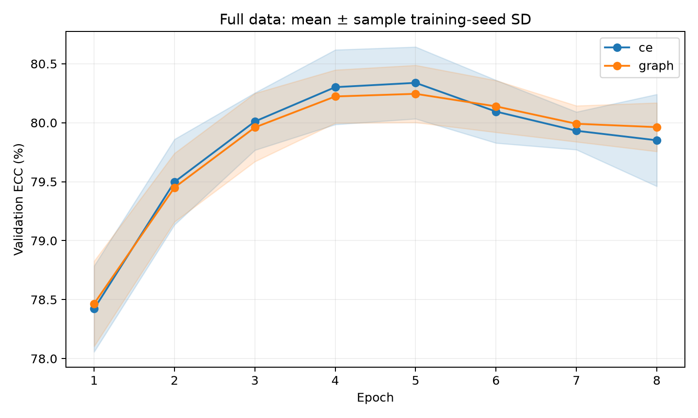

# Full-data paired-seed replication of the emotion-label graph loss

Observed mean ECC difference is -0.136 points. The seed-level Student interval includes zero, so these runs leave the benefit uncertain. The prespecified practical reference is +0.5 ECC point: these results do not establish a gain exceeding that reference.

## Locked follow-up design

This is a fresh full-data follow-up commissioned after the smaller-dataset studies. It compares CE with graph alpha=.3, gamma=1, beta=.01, using seeds [3, 4, 5, 6, 7, 8] and 8 epochs per model. It is a new local training study, not restoration of interrupted Kaggle training. Original T4 training already completed its configured eight epochs.

Train/validation/test counts are {'train': 94475, 'val': 5904, 'test': 17715}; 12 completed models and 24 checked prediction arrays. Maximum validation ECC selects each epoch checkpoint; alpha stays locked. All ResNet18 parameters are fine-tuned from ImageNet weights. Initial states and augmentation/order plans match within each seed pair. Both methods receive the same maximum budget of 11816 planned minibatches per model.

The graph signal is the eight emotion probabilities, and its inverse-Laplacian residual quadratic emphasizes low label-graph-frequency errors. This is distinct from image spatial frequency. Lower GSEE directly reflects the auxiliary objective and is not independent proof of improved emotion recognition. This focused full-data follow-up has no new isotropic/permutation controls; those mechanisms are examined separately in the medium studies.

## Fresh seed results

| Method | ACC | ECC | ACC2 | EMC | Brier | GSEE |
|---|---:|---:|---:|---:|---:|---:|
| ce | 71.3247 ± 0.2175 | 80.4617 ± 0.2017 | 91.0518 ± 0.3490 | 54.0716 ± 0.6559 | 0.3975 ± 0.0036 | 0.1944 ± 0.0018 |
| graph | 71.1177 ± 0.2240 | 80.3253 ± 0.1946 | 91.0462 ± 0.1751 | 54.0949 ± 0.5258 | 0.4009 ± 0.0036 | 0.1960 ± 0.0018 |

Means ± sample training-seed SD. ACC/ECC/ACC2/EMC are percentages; Brier/GSEE are raw probability-energy errors.

Graph-minus-CE ECC = -0.1363 points; seed Student t95 [-0.3864063005129932, 0.11375376410093985]; exact two-sided paired sign-flip p=0.21875. Positive/negative/zero seed differences: 2/4/0. Leave-one-out mean range: [-0.16731583403894207, -0.043047995376525705].

Crossed seed plus shared class-stratified image bootstrap95: [-0.4366, +0.1311], using 1500 draws. The same sampled image indices apply across all paired models.

## Multiplicity and uncertainty

The single locked full-data contrast's raw p-value is reported above. The follow-up was added after seeing the medium-study outcomes, so its timing is explicit. A ten-comparison Holm sensitivity can include the earlier nine ECC contrasts without selecting a favorable correction family.

Across the earlier nine comparisons plus this one, Holm-adjusted full-data p=1. This is a sensitivity analysis, not a claim of a ten-test plan registered before all results. The original medium-only family and raw full-data result remain visible in their respective reports.

Student t95 treats seed differences as independent and approximately normally distributed. The exact sign-flip test assumes paired treatment-label exchangeability/sign symmetry under the null. With six pairs its smallest possible two-sided p is 2/64=.03125; it has coarse resolution. The bootstrap cannot create additional independent training seeds. The +0.5 ECC-point practical reference remains unchanged; nonsignificance is not equivalence, and no TOST or achieved-power claim is made.

## Historical T4 comparison, kept separate

The historical three T4 seed pairs 0–2 gave mean graph-minus-CE ECC +0.2678, differences [0.16648522237007057, 0.3801056409015615, 0.25682432159993596], seed t95 [0.0014242520685653348, 0.5341858711791467] and exact p=0.25. The coefficient .3 was chosen using their validation sweep. These historical pairs are not pooled with the fresh six for primary inference.

The current protocol records NVIDIA GeForce RTX 5050 Laptop GPU, PyTorch 2.14.1+cu130, torchvision 0.29.1+cu130 and deterministic algorithms=True. The original jobs used T4 workers and a different framework/AMP environment. Split sizes and CSV identities are retained; hardware, runtime and explicit augmentation plans differ. This is evidence about repeatability under the documented local protocol, not a bitwise rerun of the historical training trajectory.

## AMP and runtime diagnostics

| Method | Seed | Attempted steps | Inferred skipped steps | Inferred completed steps | Epoch time total (s) |
|---|---:|---:|---:|---:|---:|
| ce | 3 | 11816 | 4 | 11812 | 627.7 |
| graph | 3 | 11816 | 4 | 11812 | 611.4 |
| ce | 4 | 11816 | 5 | 11811 | 595.2 |
| graph | 4 | 11816 | 5 | 11811 | 602.0 |
| ce | 5 | 11816 | 4 | 11812 | 593.6 |
| graph | 5 | 11816 | 3 | 11813 | 602.8 |
| ce | 6 | 11816 | 4 | 11812 | 590.2 |
| graph | 6 | 11816 | 4 | 11812 | 606.2 |
| ce | 7 | 11816 | 4 | 11812 | 593.1 |
| graph | 7 | 11816 | 4 | 11812 | 593.9 |
| ce | 8 | 11816 | 4 | 11812 | 586.0 |
| graph | 8 | 11816 | 5 | 11811 | 595.8 |

Single-optimizer standard GradScaler scale decreases infer overflow-triggered skipped optimizer steps; saved counts are checked, not independently reconstructed from batch gradients. Runtime includes validation and is descriptive; no speed advantage is inferred. Epoch-level details are in epoch_diagnostics.csv.

## Input provenance and verification

Preparation manifest SHA256: `9012a2ea76fc40e5b31560fc9624338f19248c74e3b5267ca94033aeca753a11`. Full provenance, pinned revision, source-shard hashes and exclusions are preserved in dataset_provenance.json. The full manifest's exact encoded-byte deduplication does not remove every re-encoded or near-duplicate image.

Dataset and CSV hashes, exact label order, finite normalized probabilities, all six reported metrics, every mode energy, roughness, validation checkpoint selection, executed source snapshots and paired plan hashes passed shared verification. Recorded initialization hashes agree; they are not independently regenerated by this report.

Cache shapes, dtype and byte counts match the protocol. All three cache SHA256 values were streamed and independently recomputed by this report.

All image-weighted metrics share the original fixed test split. Fresh seeds do not create an independent test dataset or psychological validation. Dataset-specific results and earlier capped-subset outcomes remain separate.
