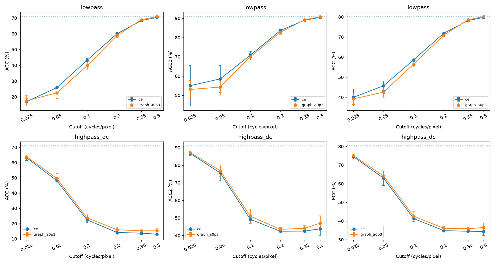
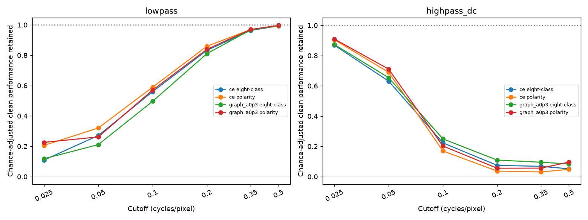
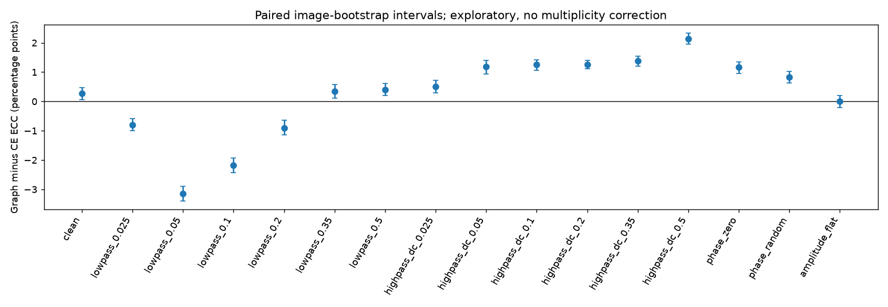
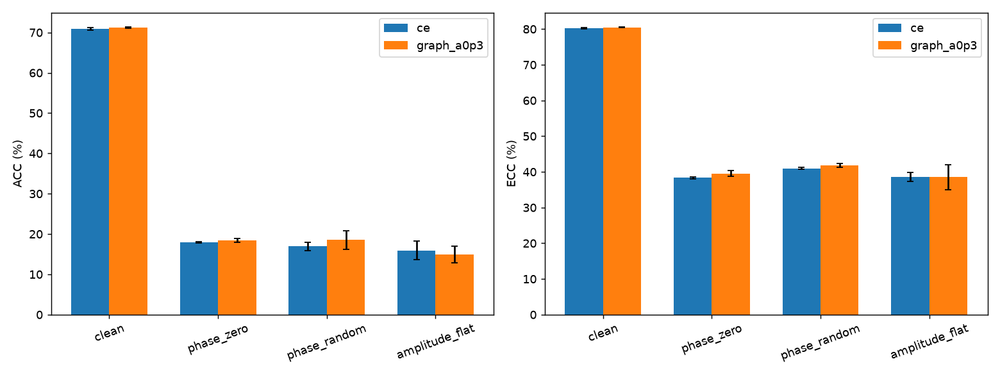

# Full EmoSet recovery and spatial-frequency follow-up

## What happened in Kaggle

Training did not stop early. All 15 runs finished their configured eight epochs, with complete histories, best-validation checkpoints and full-test predictions. The original notebook filename mentions 25 epochs, but its executed MAX_EPOCHS, MIN_EPOCHS, checkpoint metadata and histories all specify eight. The failure occurred after report generation and ZIP creation: archive.stat().st_size() calls an integer property. The correct expression is archive.stat().st_size. A second display cell repeats the same bug. Both calls are corrected in kaggle/sp_full_alpha_sweep_fixed.ipynb and kaggle/alpha_sweep_dual_t4_runner.py. No original Downloads file was overwritten.

All 15 sets of 17,715 saved test labels/probabilities and confusion matrices were checked. ACC, ECC, EMC, ACC2, GSEE and Brier were recomputed, and selected epochs were checked against validation ECC. The alpha choice was independently recovered from validation scores. This is result-artifact verification, not a rerun of Kaggle training.

## Recovered full-data results

The dataset contains 94,475 train, 5,904 validation and 17,715 test images after exact encoded-byte duplicate removal. This does not detect re-encoded duplicates or establish psychological label validity. Means below use three training seeds; +/- values are sample seed SD.

| Alpha | ACC (%) | ECC (%) | EMC (%) | Mean best validation ECC |
|---|---:|---:|---:|---:|
| 0 (CE) | 70.893 +/- 0.261 | 80.223 +/- 0.177 | 54.620 +/- 0.222 | 80.503 |
| 0.1 | 71.107 +/- 0.172 | 80.311 +/- 0.129 | 54.071 +/- 0.250 | 80.470 |
| 0.3 | 71.252 +/- 0.136 | 80.491 +/- 0.115 | 54.755 +/- 0.276 | 80.575 |
| 0.5 | 71.064 +/- 0.319 | 80.316 +/- 0.245 | 54.353 +/- 0.397 | 80.534 |
| 1.0 | 71.305 +/- 0.317 | 80.516 +/- 0.241 | 54.723 +/- 0.325 | 80.527 |

Validation selects alpha=0.3. Its full-test improvement is +0.359 ACC points and +0.268 ECC points over CE. The supplied paired class-stratified 95% image-bootstrap intervals were [0.091,0.653] for ACC and [0.078,0.471] for ECC. They are conditional on these three fitted models, not confidence over future training seeds. Alpha=1 has a slightly higher test score, but replacing the validation-selected alpha with it would use test data for model selection.

## Next experiment actually executed

Six frozen checkpoints (CE and graph alpha=0.3, seeds 0/1/2) were evaluated on all 17,715 test images in 16 conditions: clean, six low-pass cutoffs, six high-pass-plus-DC cutoffs, zero phase, randomized phase, and flattened non-DC amplitude. This is 96 model-condition evaluations / 1,700,640 image-model predictions. A 1,600-image execution pilot preceded this full evaluation; the same transform conditions were retained. There was no retraining or new alpha selection.

All conditions act on the same center-cropped 160x160 RGB inputs and the same images across all models. Cutoffs are 0.025, 0.05, 0.1, 0.2, 0.35 and 0.5 cycles/pixel. Signals remain in 0..255 scale before the saved model normalization. No per-image min-max rescaling is applied.

## Signal-processing theory and controls

Image FFT frequency is spatial variation in cycles/pixel. It is different from the label-graph eigenvalues in the GFT loss. The orthonormal two-dimensional FFT obeys Parseval energy preservation and separates a complex spectrum into magnitude and phase. Each RGB channel is transformed independently.

For radial spatial frequency r, the image-processing Butterworth-style mask is H_L(r)=1/[1+(r/f_c)^(2n)] with n=2. This explicit definition has half-amplitude response at the stated cutoff (it is not a claim of the continuous-time prototype's -3 dB amplitude convention). High-pass is 1-H_L, with the DC bin reset to one. Keeping DC avoids confounding high-pass removal with an almost-black image and preserves each channel's mean before clipping. Frequencies are periodic on the finite image grid; boundary discontinuities can influence the response.

Zero-phase and randomized-phase controls preserve Fourier magnitudes before clipping. Flattened amplitude preserves original phase, DC and pre-clipping AC energy. Real-valued reconstruction follows from Hermitian symmetry. Tests check magnitude preservation, Parseval, DC/mean preservation and the complementary-filter identity. These conditions are severe distribution shifts, not proofs of human perceptual mechanisms.

All reconstructions are clipped to [0,255] for classifier input. Clipping is nonlinear: it changes Fourier magnitudes and can alter means. The clipping fraction, resulting MSE and per-channel mean drift are saved for every condition. Consequently, phase results cannot be attributed to a pure phase intervention after clipping. In particular, high post-clipping damage makes an amplitude-preserved claim valid only before clipping.

Exact emotion has eight classes and polarity has two. Their raw accuracies have different chance levels. The retention plot uses balanced accuracies and (filtered-chance)/(clean-chance), with 12.5% chance for eight classes and 50% for polarity, to avoid interpreting the easier binary task as automatic evidence of coarse-to-fine perception.





## Measured condition results

| Condition | CE ECC | Graph ECC | Graph-CE ECC points | Conditional 95% interval | Pixel clipping |
|---|---:|---:|---:|---|---:|
| clean | 80.225 | 80.490 | +0.266 | [+0.061, +0.470] | 0.00% |
| lowpass_0.025 | 39.983 | 39.191 | -0.792 | [-0.997, -0.581] | 0.67% |
| lowpass_0.05 | 45.736 | 42.589 | -3.147 | [-3.399, -2.901] | 0.90% |
| lowpass_0.1 | 58.664 | 56.490 | -2.174 | [-2.423, -1.935] | 0.91% |
| lowpass_0.2 | 71.868 | 70.964 | -0.904 | [-1.147, -0.642] | 0.88% |
| lowpass_0.35 | 78.200 | 78.550 | +0.350 | [+0.116, +0.570] | 0.98% |
| lowpass_0.5 | 79.762 | 80.166 | +0.404 | [+0.193, +0.620] | 0.95% |
| highpass_dc_0.025 | 74.522 | 75.036 | +0.514 | [+0.292, +0.730] | 0.97% |
| highpass_dc_0.05 | 62.969 | 64.149 | +1.180 | [+0.933, +1.403] | 0.49% |
| highpass_dc_0.1 | 41.304 | 42.558 | +1.254 | [+1.069, +1.424] | 0.19% |
| highpass_dc_0.2 | 34.826 | 36.085 | +1.259 | [+1.123, +1.409] | 0.04% |
| highpass_dc_0.35 | 34.499 | 35.882 | +1.383 | [+1.209, +1.551] | 0.01% |
| highpass_dc_0.5 | 34.327 | 36.467 | +2.140 | [+1.959, +2.327] | 0.00% |
| phase_zero | 38.366 | 39.529 | +1.163 | [+0.955, +1.355] | 2.80% |
| phase_random | 40.984 | 41.821 | +0.837 | [+0.636, +1.033] | 7.70% |
| amplitude_flat | 38.520 | 38.530 | +0.011 | [-0.207, +0.206] | 6.51% |



Intervals use 1,000 paired class-stratified image bootstrap replicates, with the same resampled indices shared across all model seeds. They preserve the observed class counts and are conditional on these models. There is no multiplicity correction across the 16 inspected conditions; treat the results as exploratory. Degradation-adjusted graph advantages (filtered advantage minus clean advantage) are separately saved in paired_comparisons.json to distinguish robustness from a pre-existing clean-score difference.

## Findings supported by these measurements

The graph objective is not uniformly more robust to spatial filtering. At lowpass_0.05, graph-minus-CE ECC is -3.147 points; at highpass_dc_0.5 it is +2.140 points. These condition-dependent outcomes show that label-graph regularization and image-frequency robustness are distinct questions.

Clean replay on this machine gives CE ECC 80.225 and graph ECC 80.490. Small differences from the saved Kaggle clean scores are measured in checkpoint_replay.json: T4 versus RTX 5050 and framework/AMP differences mean replay is numerically close rather than bitwise identical.

Phase and amplitude manipulations reduce recognition substantially compared with clean images. That supports the dependence of these fitted classifiers on the altered signal structure. It does not establish that phase exclusively encodes emotion, that low frequencies always preserve polarity, or that this experiment proves Reverse Hierarchy Theory. The chance-adjusted retention curves and clipping diagnostics are necessary to assess those narrower hypotheses.



## Continuation and reproducibility

The next experiment is complete locally and its probabilities/labels are saved under outputs/full_spatial_frequency. A future 25-epoch study would be a new training-budget comparison, not recovery of missing epochs. Preserve equal budgets for CE and a graph coefficient locked using validation; do not choose a new alpha from this test study. The original last_resume.pt files include model, optimizer and AMP scaler but omit RNG states, so they cannot guarantee an exact uninterrupted training trajectory. They remain in the original workspace ZIP.

Commands (activate the project environment or use its Python executable):

```powershell
python scripts/import_sp_kaggle.py "C:/Users/thota/Downloads/_output_.zip"
python scripts/run_spatial_frequency.py --per-class 0 --out outputs/frequency_reproduction
python scripts/report_spatial_frequency.py --out outputs/frequency_reproduction
```

The local CUDA runtime lives in work/cuda_runtime; use scripts/run_spatial_frequency.ps1 on this machine. For another machine install compatible CUDA PyTorch normally. Protocol and source snapshots are saved with the experiment; use a fresh output directory if protocol settings change. No repository push was performed.

Primary references: [original emotion evaluation paper](https://proceedings.neurips.cc/paper_files/paper/2024/hash/f2bb120e9a2cb9c2a50921b7f865c421-Abstract-Conference.html), [graph signal processing](https://arxiv.org/abs/1211.0053), [2D Fourier image processing](https://docs.opencv.org/4.13.0/de/dbc/tutorial_py_fourier_transform.html).