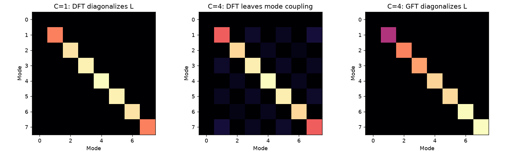
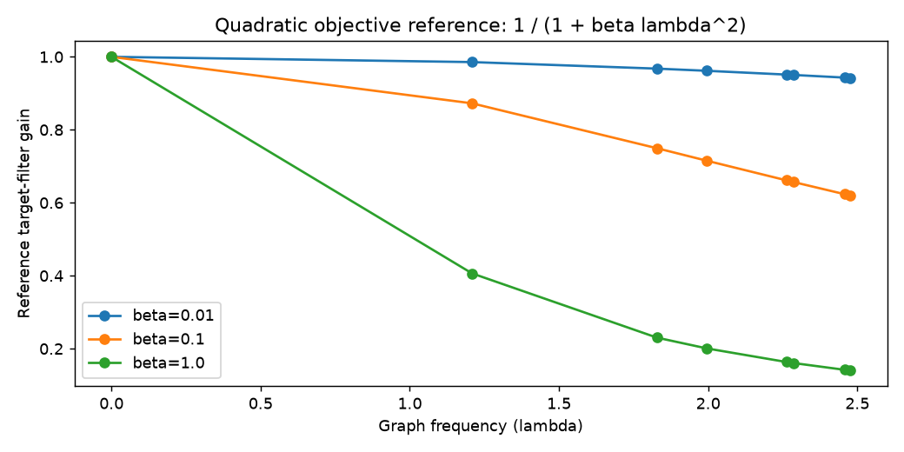
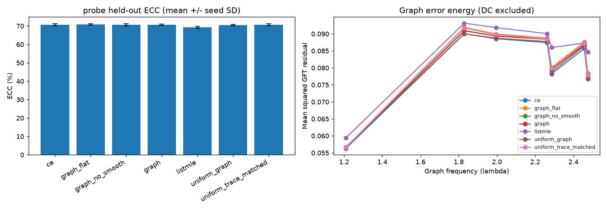
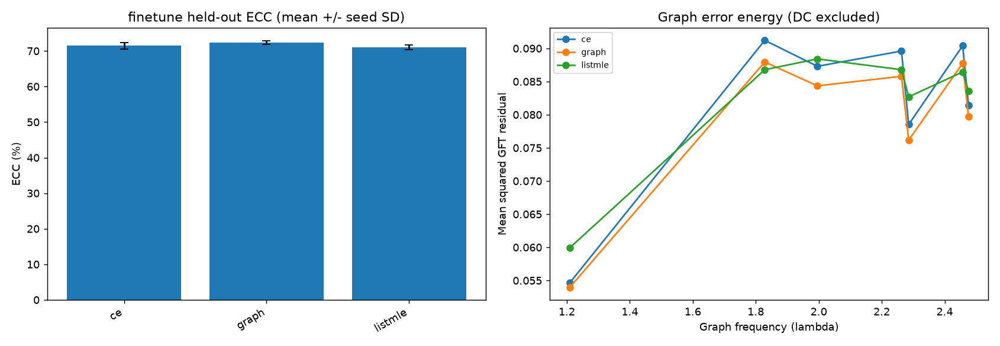
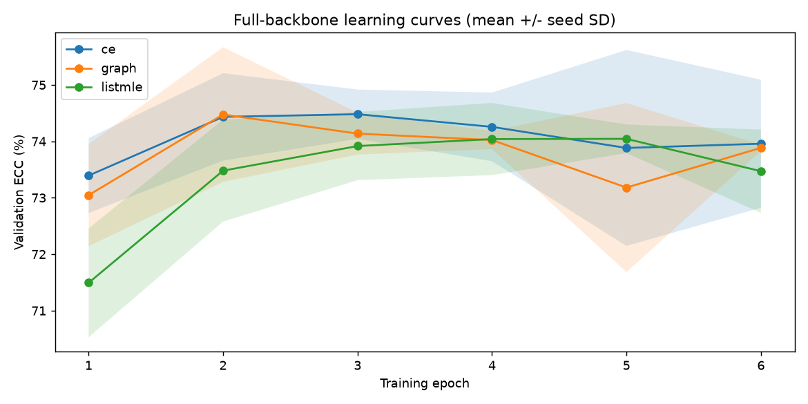
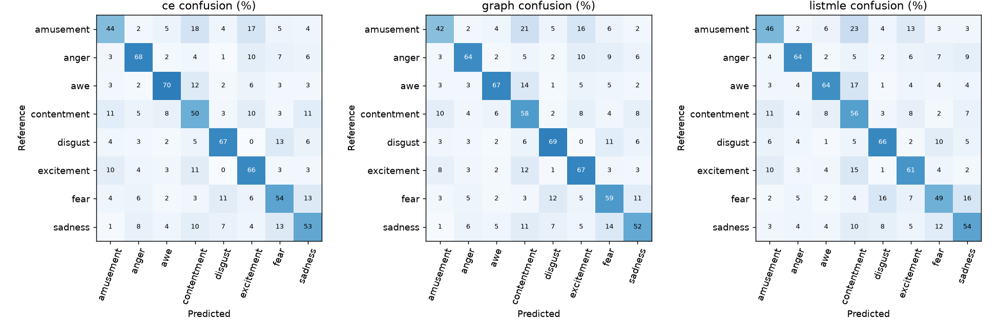
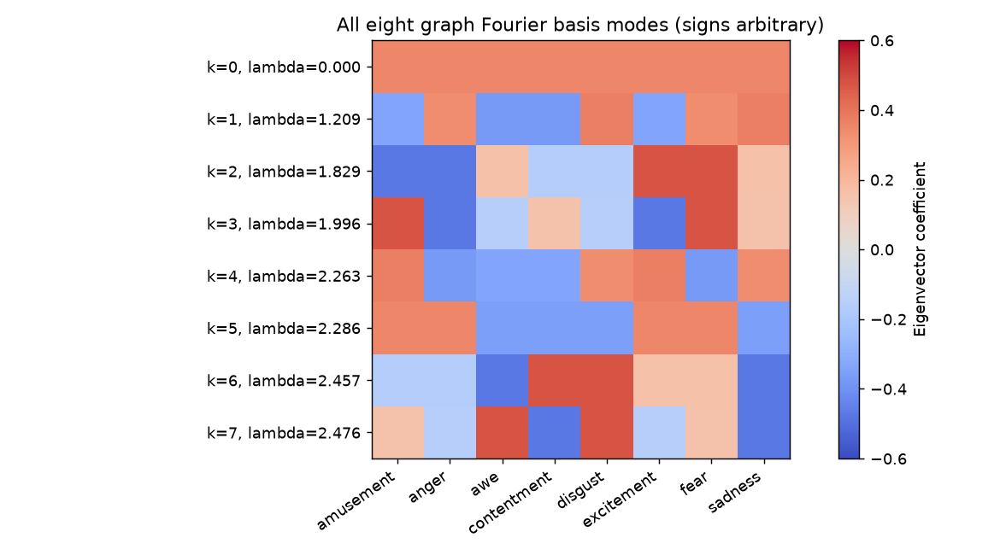
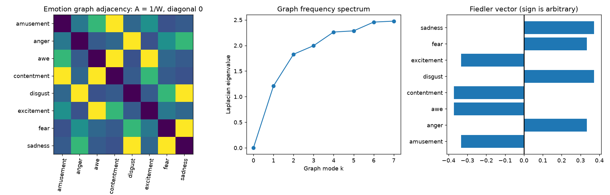
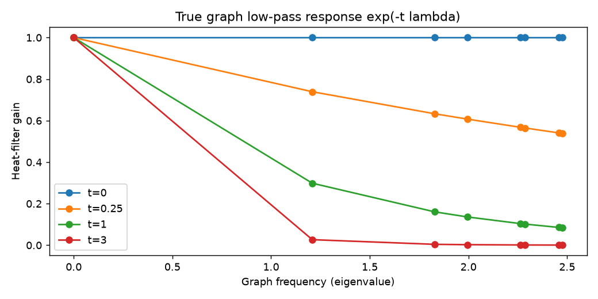

# Graph signal processing for visual emotion recognition

## Scope and provenance

This experiment implements the attached Idea 1 on real EmoSet photographs. The eight class probabilities form a signal on the LABEL graph. Graph frequency is variation across emotion vertices; it is not spatial frequency in the input photograph. Idea 2 is deferred.

The source repository was audited at base commit 21abe4fa8ea36fe23139e6c18a41d8491bcaffef. It already contained ResNet training, ACC/ACC2/ECC/EMC, ListMLE, FixMatch threshold adaptation, and minimum-cost decoding. README results are historical reported results, not independently rerun FI benchmarks. GSP was absent. The official author code is partial; its metric.py does not define the wheel. This implementation preserves the existing wheel and checks invariance rather than silently redefining it. S2-VER integration and user study remain outside this experiment.

Mirror: udeman/EmoSet-118K at revision cd2344cbf316bd77331ee63a79ce6999f0bf7572. Source shard SHA256 hashes and exact selected image identifiers are in data/emoset_source/provenance.json and data/emoset_graph/*csv. The subset preserves the mirror train/val/test assignments. It is a deterministic capped sample from selected shards, not a random sample of all 118K images, and is not the official full benchmark.

| Split | Images | Per-class counts |
|---|---:|---|
| train | 4800 | {'awe': 600, 'disgust': 600, 'excitement': 600, 'anger': 600, 'contentment': 600, 'fear': 600, 'sadness': 600, 'amusement': 600} |
| val | 800 | {'contentment': 100, 'disgust': 100, 'sadness': 100, 'excitement': 100, 'awe': 100, 'fear': 100, 'amusement': 100, 'anger': 100} |
| test | 1600 | {'sadness': 200, 'excitement': 200, 'disgust': 200, 'contentment': 200, 'amusement': 200, 'awe': 200, 'anger': 200, 'fear': 200} |

RGB pixel hashes remove exact duplicates within and across splits; invalid images are excluded and logged. Near-duplicates are not detected. Images are stored at at most 320 pixels on their longest side. Model transforms resize to 192x192 and crop to 160x160. Train crops/flips are used for full fine-tuning. These choices differ from the paper and limit numerical comparability.

## Mathematical connection to signal processing

Let A_ij = 1/W_ij for i != j, A_ii = 0, D_ii = sum_j A_ij, and L = D-A = U diag(lambda) U^T. This is a dense weighted graph induced by the wheel distances, not a ring-only adjacency. The GFT of a class-probability signal p is U^T p; its inverse is U p_hat. U is orthonormal, giving Parseval energy preservation.

The Dirichlet identity is p^T L p = 1/2 sum_ij A_ij (p_i-p_j)^2 = sum_k lambda_k p_hat_k^2. Thus high graph frequency means rapid variation across strongly connected emotion vertices. No physiological time or physical hertz is involved.

Classical DFT connection: in circular wheel order, setting C=1 makes A and L circulant. The ordinary eight-point complex DFT then diagonalizes L (off-diagonal norm 6.982e-15). At C=4 the polarity boundary breaks that rotational invariance: DFT-domain off-diagonal coupling has Frobenius norm 0.699955. The graph eigenbasis restores diagonalization. Thus this is an explicit generalization of classical Fourier-mode analysis to a nonuniform label graph, not merely use of an unrelated eigendecomposition.

Computed eigenvalues: [0.0, 1.208797, 1.828562, 1.99571, 2.262631, 2.285714, 2.457152, 2.475719]. The Fiedler vector separates polarity: True; absolute correlation with the polarity vector: 0.998524. This follows from the chosen label geometry and is not a learned discovery about human brains. Eigenvector signs are arbitrary.

Implemented objective: CE + alpha [sum_(k>0) lambda_k^(-gamma) |u_k^T(p-y)|^2 + beta p^T L p]. Default alpha=1, gamma=1, beta=0.01. The spectral residual term weights LOW-frequency errors more heavily. For gamma=1 it equals (p-y)^T L^+ (p-y), using the Laplacian pseudoinverse. It is an inverse-order graph norm, not the usual positive-order Sobolev/Dirichlet penalty. It is not itself a low-pass filter applied to p. A true heat filter has response exp(-t lambda); its response is plotted separately. At gamma=0 the spectral residual term equals the Brier error because the residual DC component vanishes.

Both p and one-hot y sum to one, so their residual has zero DC. Excluding the zero eigenvalue is mathematically necessary. The Dirichlet penalty alone favors a constant (uniform) probability vector; the fidelity and CE terms oppose this collapse. Smaller energy is not automatically higher accuracy. The supplied text's claims that ListMLE is computationally heavy, that EMC is an SNR, or that weighted confusion scoring is a physical matched filter are not established by these experiments.

A stronger theoretical prediction follows by isolating the quadratic auxiliary objective and temporarily ignoring CE and probability nonnegativity. For each non-DC mode, minimizing lambda^(-gamma)(p_hat-y_hat)^2 + beta lambda p_hat^2 gives p_hat = y_hat / (1 + beta lambda^(gamma+1)). Keep DC fixed to preserve unit mass. Thus the unconstrained quadratic reference solution is a graph low-pass response. This is not an exact solution of softmax-constrained CE training; the reference kernel is not guaranteed to map every distribution to nonnegative probabilities.
With gamma=1 and beta=0.01, the reference gain is 0.985599 on the first non-DC mode and 0.942248 on the highest mode. Therefore the proposed beta supplies only mild smoothing on this graph. A small difference from the beta=0 ablation is theoretically plausible, rather than evidence that the transform is broken.

GSEE is defined here as mean inverse-eigenvalue-weighted probability residual energy. It is a descriptive experimental quantity, not a validated replacement for ECC/EMC. Per-mode mean squared residuals are graph error energy, not an estimated stationary PSD. Repeated eigenvalues must be interpreted using total eigenspace energy rather than individual basis vectors.

## Protocol and comparisons

All methods use the same class order, data partitions, three seeds (0,1,2), pretrained ImageNet ResNet18 weights, optimizer within a stage, and maximum validation ECC checkpoint selection. Test data never chooses epochs or hyperparameters. Coefficients are fixed in advance; there is no post-test tuning. The frozen-feature probe isolates loss effects at low computational cost and includes no-smooth, flat-frequency and uniform-graph controls. Full-backbone fine-tuning separately compares CE, CE+0.2 ListMLE, and CE+graph. The two stages must not be combined into a single ranking.

ACC/ECC/EMC/ACC2 are percentages, higher better. Brier and GSEE are raw probability-energy errors, lower better. EMC describes a changing subset of mistakes, so error counts accompany it. Uniform-graph performance is scored on the same emotional graph as all other methods. Seed standard deviations below are sample standard deviations.

## Executed probe results

| Method | Runs | ACC | ECC | EMC | ACC2 | GSEE | Seconds/run |
|---|---:|---:|---:|---:|---:|---:|---:|
| ce | 3 | 57.833 +/- 0.915 | 70.723 +/- 0.602 | 51.168 +/- 0.319 | 84.125 +/- 0.390 | 0.279 +/- 0.002 | 24.3 |
| graph_flat | 3 | 58.021 +/- 0.407 | 70.933 +/- 0.411 | 51.652 +/- 0.720 | 84.479 +/- 0.581 | 0.284 +/- 0.002 | 25.7 |
| graph_no_smooth | 3 | 57.875 +/- 0.676 | 70.725 +/- 0.542 | 51.079 +/- 0.404 | 84.021 +/- 0.632 | 0.282 +/- 0.001 | 27.0 |
| graph | 3 | 57.917 +/- 0.469 | 70.760 +/- 0.405 | 51.109 +/- 0.421 | 84.021 +/- 0.581 | 0.282 +/- 0.001 | 29.2 |
| listmle | 3 | 55.438 +/- 0.721 | 69.311 +/- 0.612 | 52.413 +/- 0.800 | 83.875 +/- 0.312 | 0.293 +/- 0.004 | 28.5 |
| uniform_graph | 3 | 57.562 +/- 0.390 | 70.526 +/- 0.331 | 51.193 +/- 0.187 | 83.896 +/- 0.581 | 0.280 +/- 0.002 | 29.9 |
| uniform_trace_matched | 3 | 57.833 +/- 0.581 | 70.779 +/- 0.484 | 51.498 +/- 0.428 | 84.375 +/- 0.603 | 0.283 +/- 0.002 | 26.3 |

Heat diffusion is selected only using validation ECC from t in {0, 0.1, 0.3, 1.0}. The following held-out results are separate from the primary unfiltered scores:

| Method | Mean selected t | Filtered ECC | Filtered ACC |
|---|---:|---:|---:|
| ce | 0.433 | 70.676 | 57.729 |
| graph_flat | 0.033 | 70.940 | 58.021 |
| graph_no_smooth | 0.233 | 70.694 | 57.812 |
| graph | 0.167 | 70.701 | 57.812 |
| listmle | 0.033 | 69.301 | 55.417 |
| uniform_graph | 0.667 | 70.505 | 57.604 |
| uniform_trace_matched | 0.133 | 70.709 | 57.729 |

Graph minus CE ECC: 0.036 percentage points. Class-stratified paired image-bootstrap 95% interval: [-0.458, 0.543]. The same resampled image indices are shared across seeds and class counts remain fixed. This interval is conditional on these trained models and this shard subset; it does not estimate generalization across all possible training seeds or populations.

The paired interval includes zero; this experiment does not establish an ECC improvement.

## Executed finetune results

| Method | Runs | ACC | ECC | EMC | ACC2 | GSEE | Seconds/run |
|---|---:|---:|---:|---:|---:|---:|---:|
| ce | 3 | 58.896 +/- 1.442 | 71.478 +/- 0.961 | 51.303 +/- 0.460 | 84.875 +/- 0.286 | 0.282 +/- 0.012 | 120.9 |
| graph | 3 | 60.021 +/- 0.485 | 72.320 +/- 0.499 | 51.796 +/- 1.083 | 85.188 +/- 0.710 | 0.274 +/- 0.006 | 124.0 |
| listmle | 3 | 57.521 +/- 0.898 | 70.972 +/- 0.641 | 53.768 +/- 0.342 | 84.938 +/- 0.488 | 0.285 +/- 0.009 | 113.5 |

Heat diffusion is selected only using validation ECC from t in {0, 0.1, 0.3, 1.0}. The following held-out results are separate from the primary unfiltered scores:

| Method | Mean selected t | Filtered ECC | Filtered ACC |
|---|---:|---:|---:|
| ce | 1.000 | 71.388 | 58.771 |
| graph | 0.100 | 72.329 | 60.000 |
| listmle | 0.100 | 70.964 | 57.500 |

Graph minus CE ECC: 0.842 percentage points. Class-stratified paired image-bootstrap 95% interval: [0.157, 1.501]. The same resampled image indices are shared across seeds and class counts remain fixed. This interval is conditional on these trained models and this shard subset; it does not estimate generalization across all possible training seeds or populations.

This subset supports an ECC benefit conditional on the tested models, but broader validation is needed.

## Electrical-network interpretation of the spectral residual

For gamma=1, the residual z=p-y has zero total mass and the graph loss is z^T L^+ z. Let a zero-mean potential q solve Lq=z. Then z^T L^+ z=q^T Lq, the same Dirichlet energy identity as a balanced-current resistor network whose conductances are A. For a hard wrong prediction j on reference i, z=e_j-e_i and the quantity becomes the effective resistance between those vertices. Thus the proposed loss has an exact network-energy interpretation. The actual graph is a mathematical label-similarity model, not a measured physical circuit or a measurement of human emotions.

## What is established and what remains open

The graph construction, transform inversion, Parseval identity, Dirichlet identity, pseudoinverse interpretation, permutation invariance and differentiable optimization have explicit tests. A loss improvement is a separate empirical question. Three seeds and a capped shard subset provide a controlled pilot rather than a full NeurIPS reproduction. Data-label subjectivity, shard-selection bias, shorter training, fixed loss scaling, and ImageNet transfer limit conclusions. An inverse-frequency loss can improve probability energy without changing argmax decisions; that is not a contradiction.

The graph was constructed from the same wheel used by ECC/EMC. Good agreement between GSEE and ECC is not independent psychological validation. Checkpoint selection on ECC favors that target; ACC is reported alongside it. The supplied proposal's expectation that all metrics improve is not a required or guaranteed outcome.

Uniform-graph controls remove emotion geometry. The raw uniform graph also changes the eigenvalue scale; the additional trace-matched uniform control preserves total edge weight to reduce that confound. It does not match every eigenvalue or inverse-spectrum moment. gamma=0 changes both weighting shape and auxiliary-loss scale. Interpret these ablations as diagnostic comparisons, not perfect causal isolation. Runtime measurements include validation and overlapping CPU/GPU studies and do not establish an isolated speed advantage.

The theoretical smoothing failure is explicit: uniform probabilities have zero Dirichlet energy, yet argmax ties predict a single class and achieve only 12.5% ACC on this balanced test set. A one-hot target requires non-DC graph modes for class discrimination. Lower graph roughness alone therefore cannot define a good classifier; CE, spectrum-resolved errors and held-out decision metrics remain essential.

## Reproduction

Run the PowerShell commands in docs/GRAPH_EXPERIMENT.md from the repository root. Exact source shard revision and hashes, dataset CSVs, protocol JSON, per-epoch histories, selected model weights, test probabilities, confusion matrices, environment freeze and test log are preserved locally. Completed runs are skipped by directory; use a fresh output directory or deliberately archive old results before changing the protocol. Mid-run resume is not implemented in the comparison runner; the existing supervised runner retains its checkpoint/resume support.

## Primary references

- Original emotion-evaluation paper: https://proceedings.neurips.cc/paper_files/paper/2024/hash/f2bb120e9a2cb9c2a50921b7f865c421-Abstract-Conference.html
- Shuman et al., The Emerging Field of Signal Processing on Graphs: https://arxiv.org/abs/1211.0053
- Smola and Kondor, Kernels and Regularization on Graphs: https://people.cs.uchicago.edu/~risi/papers/SmolaKondor.pdf
- Spielman and Srivastava, Graph Sparsification by Effective Resistances: https://arxiv.org/abs/0803.0929
- EmoSet, ICCV 2023 official repository: https://github.com/JingyuanYY/EmoSet
- EmoSet mirror used here: https://huggingface.co/datasets/udeman/EmoSet-118K

