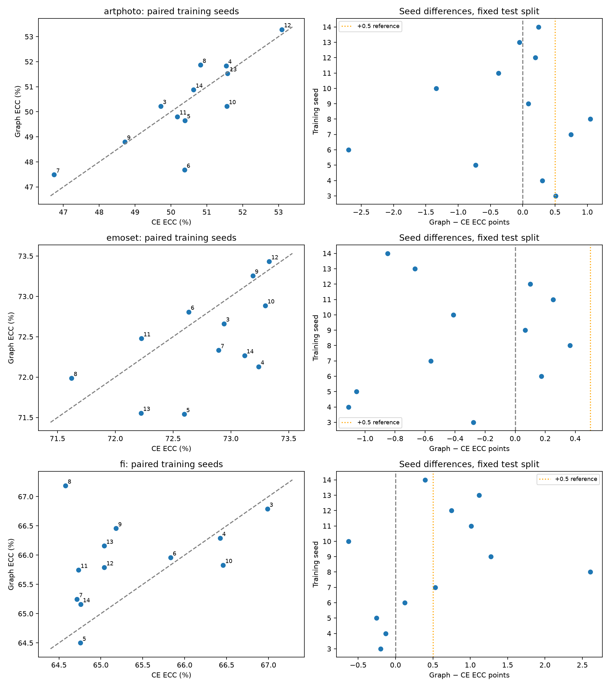
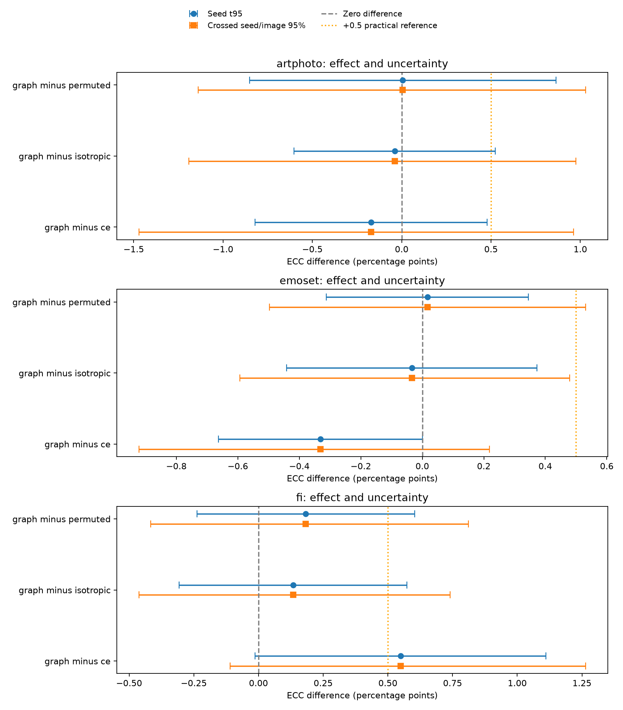
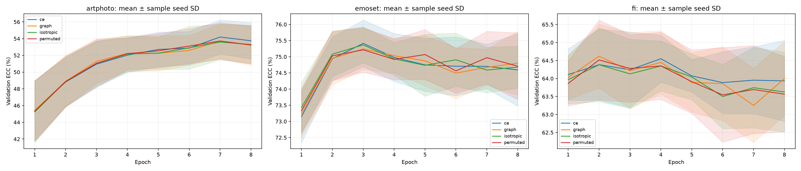
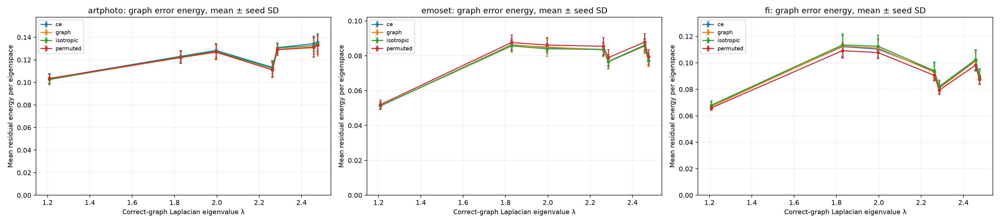

# Fresh paired-seed evidence for the emotion-label graph loss

This study asks whether the observed ECC benefit repeats across training seeds and whether emotional geometry contributes beyond a matched generic quadratic. Each dataset is analyzed separately. No pooled dataset confidence interval is reported.

## Locked comparison and signal-processing meaning

CE, graph, isotropic and wrong-label-permuted graph use identical pretrained initialization and explicit crop/flip/order plans within each seed. These are full-backbone fine-tuning runs: the optimizer receives all model parameters. The raw protocol's phrase 'fixed backbone' describes the common starting ImageNet weights, not frozen backbone parameters; raw executed protocols and source snapshots are preserved unchanged. The coefficient stays alpha=0.3, gamma=1 and beta=0.01; no test-driven alpha choice is made. Epochs are selected only by validation ECC. Every method has the same training budget within its dataset.

The signal is the eight emotion probabilities on a weighted label graph. The graph residual quadratic uses Q=L+ (the Laplacian pseudoinverse), emphasizing low graph-frequency residuals; the separate p^T L p term penalizes roughness. These graph frequencies are distinct from spatial image FFT frequencies. The isotropic control independently matches tr(Q) and tr(L), removing graph direction while matching average quadratic scales. The wrong-label control preserves the entire spectrum under a vertex permutation but breaks alignment with emotion labels. Its preassigned permutation varies by seed, so that comparison includes random-geometry variation as well as training variation.

## Dataset provenance and data-quality findings

Data quality was audited during preparation, before the FI model outcomes. These are fixed custom capped/split datasets with documented sources; neither a capped subset nor a nonstandard split is an official full-benchmark reproduction.

**fi placeholder correction before training.** The preparation audit found a decoded-pixel group with conflicting emotion labels: 1,356 raw members shared a placeholder image. Every member of the ambiguous group was excluded before split assignment, replacing the earlier first-label duplicate policy. The original resized-input diagnostic counted 1376 repeated rows; that count and the ambiguous-group membership overlap and must not be added together. The final rejection categories and retained counts are preserved verbatim in dataset_provenance.json. Original artifacts remain in `pre_ambiguity_cleanup`. This correction used image identity and label consistency rather than model performance.

| Dataset | Raw archive rows / selected-shard availability | Usable before caps | Actual train | Actual validation | Actual test |
|---|---:|---:|---:|---:|---:|
| artphoto | 806 | 783 | 468 | 155 | 160 |
| emoset | 17,880 (selected shards only) | not recorded | 4,800 | 800 | 1,600 |
| fi | 23,185 | 21,808 | 4,777 | 800 | 1,593 |

Per-class caps are maxima, not a guarantee of perfect class balance. The verified actual CSV counts govern the experiment. Datasets with unequal class counts in at least one split: artphoto, fi. The older EmoSet manifest records available shard rows and selected counts but does not record all usable pre-cap image counts, so that value is left unknown.

### artphoto: source and preprocessing

- Mirror: `wudq/Small-Scale_VSA_Datasets`; pinned revision: `476a96fdfc8330626bf60ce686008bed5605e5c0`.
- Source: [https://huggingface.co/datasets/wudq/Small-Scale_VSA_Datasets/resolve/476a96fdfc8330626bf60ce686008bed5605e5c0/testImages_artphoto.zip](https://huggingface.co/datasets/wudq/Small-Scale_VSA_Datasets/resolve/476a96fdfc8330626bf60ce686008bed5605e5c0/testImages_artphoto.zip).
- Raw-count scope: raw archive image rows.
- Prepared images: PIL bilinear resize192x192; PNG lossless storage (preparation manifest).
- Classifier input pipeline: PIL EXIF transpose RGB; Resize192x192; random crop160/flip0.5 train; center160 val/test.
- Split rule: 60/20/20 stratified by class after exact deduplication; optional per-class caps; fixed custom split, not official paper split.
- Actual class counts in protocol class order ['amusement', 'anger', 'awe', 'contentment', 'disgust', 'excitement', 'fear', 'sadness']: train [60, 46, 60, 42, 42, 58, 61, 99]; validation [20, 15, 20, 14, 14, 19, 20, 33]; test [21, 16, 20, 14, 14, 20, 21, 34].
- Exclusion limits: Only encoded hashes provided by full EmoSet manifests and original pixel hashes provided by pilot manifests are checked. Re-encoded/near duplicates and other unprovided source images remain possible..
- Verified preparation manifest SHA256: `ac96cc8acfa4f4578ec945d2c4833a34592adbc62b78a4f100ec8447bec9e2f1`.
- Archive `testImages_artphoto.zip` SHA256: `70e261192a414ad50a02d359ec8712a3b0c5336d149aa671364ea0a74f0dae3c`.

### emoset: source and preprocessing

- Mirror: `udeman/EmoSet-118K`; pinned revision: `cd2344cbf316bd77331ee63a79ce6999f0bf7572`.
- Source: [https://huggingface.co/datasets/udeman/EmoSet-118K/tree/cd2344cbf316bd77331ee63a79ce6999f0bf7572](https://huggingface.co/datasets/udeman/EmoSet-118K/tree/cd2344cbf316bd77331ee63a79ce6999f0bf7572).
- Raw-count scope: rows available in selected mirror shards, not the complete original dataset.
- Prepared images: EXIF-transposed RGB; thumbnail at most320x320 LANCZOS; JPEG quality95 (project scripts/prepare_graph_data.py; not recorded in the older manifest schema).
- Classifier input pipeline: PIL EXIF transpose RGB; Resize192x192; random crop160/flip0.5 train; center160 val/test.
- Split rule: Preserved mirror splits with per-class shard-subset caps; not the complete benchmark.
- Actual class counts in protocol class order ['amusement', 'anger', 'awe', 'contentment', 'disgust', 'excitement', 'fear', 'sadness']: train [600, 600, 600, 600, 600, 600, 600, 600]; validation [100, 100, 100, 100, 100, 100, 100, 100]; test [200, 200, 200, 200, 200, 200, 200, 200].
- Exclusion limits: Exact decoded-pixel duplicate checking during capped subset preparation; near/re-encoded duplicates and uninspected images remain possible.
- Verified preparation manifest SHA256: `af89fd8f7b3206c6eabad881c31e0603202602333d72d4d3b42778986a8533c4`.
- Source shard `data/train-00000-of-00018.parquet` SHA256: `090a4bcd42c1a2feba914c5662da0cf06bd2b6a3e1a57bbbb963106d7731cdb7`.
- Source shard `data/train-00001-of-00018.parquet` SHA256: `090a2ad2f16ffee48ae449b4a2e477daf0e096a6ffdacd83d78a6f38aa1a8a37`.
- Source shard `data/val-00000-of-00002.parquet` SHA256: `cdd16d7cc23a9c08adc46f94e465982bced2d4082f229cc5c4d279ab3eb2a95e`.
- Source shard `data/test-00000-of-00004.parquet` SHA256: `fe84c3ffe78431afbdefff771db4bcdecd2fa04c82bd8b28c11a560a07b59f12`.

### fi: source and preprocessing

- Mirror: `wudq/Small-Scale_VSA_Datasets`; pinned revision: `476a96fdfc8330626bf60ce686008bed5605e5c0`.
- Source: [https://huggingface.co/datasets/wudq/Small-Scale_VSA_Datasets/resolve/476a96fdfc8330626bf60ce686008bed5605e5c0/FI_dataset.tar](https://huggingface.co/datasets/wudq/Small-Scale_VSA_Datasets/resolve/476a96fdfc8330626bf60ce686008bed5605e5c0/FI_dataset.tar).
- Raw-count scope: raw archive image rows.
- Prepared images: PIL bilinear resize192x192; PNG lossless storage (preparation manifest).
- Classifier input pipeline: PIL EXIF transpose RGB; Resize192x192; random crop160/flip0.5 train; center160 val/test.
- Split rule: 60/20/20 stratified by class after exact deduplication; optional per-class caps; fixed custom split, not official paper split.
- Actual class counts in protocol class order ['amusement', 'anger', 'awe', 'contentment', 'disgust', 'excitement', 'fear', 'sadness']: train [600, 600, 600, 600, 600, 600, 577, 600]; validation [100, 100, 100, 100, 100, 100, 100, 100]; test [200, 200, 200, 200, 200, 200, 193, 200].
- Exclusion limits: Only encoded hashes provided by full EmoSet manifests and original pixel hashes provided by pilot manifests are checked. Re-encoded/near duplicates and other unprovided source images remain possible..
- Verified preparation manifest SHA256: `d8db599a37d2e924c0b734dd4a731e719de130447498a40f1031f1d67ff2036a`.
- Archive `FI_dataset.tar` SHA256: `4c296245bdb31e6727b6aea806bada120a82b5651f966881956f2a62c45958da`.

The report verifies the preparation manifest against `protocol.data_manifest_sha256` and preserves the complete original schema in [dataset_provenance.json](dataset_provenance.json). Archive/shard hashes are provenance recorded by preparation; this report does not re-download or independently rehash all source archives. Historical exclusion-source records can refer to preserved preparation snapshots rather than subsequently corrected CSV files. Exact-hash exclusion cannot rule out re-encoded, resized or near-duplicate overlap, and different emotion labels remain subjective.

## New experiments

### artphoto

12 fresh seed pairs [3, 4, 5, 6, 7, 8, 9, 10, 11, 12, 13, 14]; 8 epochs per run. Train/validation/test counts: {'train': 468, 'val': 155, 'test': 160}. Four methods, 48 completed runs. Planned training minibatches per run: 64.

| Method | ACC | ECC | ACC2 | EMC | Brier | GSEE |
|---|---:|---:|---:|---:|---:|---:|
| ce | 30.7292 ± 2.1458 | 50.4453 ± 1.6016 | 67.0833 ± 1.9094 | 46.9146 ± 2.3293 | 0.8693 ± 0.0255 | 0.4341 ± 0.0121 |
| graph | 30.7812 ± 2.3556 | 50.2734 ± 1.7390 | 66.8229 ± 2.8760 | 46.1089 ± 2.8293 | 0.8552 ± 0.0333 | 0.4277 ± 0.0149 |
| isotropic | 30.6771 ± 2.2841 | 50.3127 ± 1.7105 | 66.9271 ± 2.8760 | 46.6085 ± 2.0527 | 0.8632 ± 0.0281 | 0.4311 ± 0.0126 |
| permuted | 30.6771 ± 2.7882 | 50.2678 ± 2.1477 | 66.8750 ± 2.5975 | 46.3830 ± 2.0240 | 0.8574 ± 0.0308 | 0.4289 ± 0.0140 |

Values are mean ± sample training-seed SD; ACC/ECC/ACC2/EMC are percentages, Brier/GSEE are raw energy errors. Lower Brier/GSEE is better.

**graph minus ce (primary).** Observed mean ECC difference is -0.172 points. The seed-level Student interval includes zero, so these runs leave the benefit uncertain. Exact sign-flip Holm-adjusted p=1; the familywise test does not reject at 0.05. The prespecified practical reference is +0.5 ECC point: these results do not establish a gain exceeding that reference.

Seed t95 [-0.821, +0.477]; crossed seed/image percentile interval [-1.470, +0.962]. Positive/negative/zero pairs: 7/5/0. Leave-one-seed-out mean range: [-0.2826028138528142, 0.057697510822510296].

**graph minus isotropic (secondary mechanistic control).** Observed mean ECC difference is -0.039 points. The seed-level Student interval includes zero, so these runs leave the benefit uncertain. Exact sign-flip Holm-adjusted p=1; the familywise test does not reject at 0.05. The prespecified practical reference is +0.5 ECC point: these results do not establish a gain exceeding that reference.

Seed t95 [-0.603, +0.525]; crossed seed/image percentile interval [-1.191, +0.974]. Positive/negative/zero pairs: 5/7/0. Leave-one-seed-out mean range: [-0.16247294372294424, 0.12919372294372133].

**graph minus permuted (secondary mechanistic control).** Observed mean ECC difference is +0.006 points. The seed-level Student interval includes zero, so these runs leave the benefit uncertain. Exact sign-flip Holm-adjusted p=1; the familywise test does not reject at 0.05. The prespecified practical reference is +0.5 ECC point: these results do not establish a gain exceeding that reference.

Seed t95 [-0.852, +0.863]; crossed seed/image percentile interval [-1.139, +1.029]. Positive/negative/zero pairs: 4/8/0. Leave-one-seed-out mean range: [-0.2118506493506522, 0.2890286796536763].

### emoset

12 fresh seed pairs [3, 4, 5, 6, 7, 8, 9, 10, 11, 12, 13, 14]; 8 epochs per run. Train/validation/test counts: {'train': 4800, 'val': 800, 'test': 1600}. Four methods, 48 completed runs. Planned training minibatches per run: 600.

| Method | ACC | ECC | ACC2 | EMC | Brier | GSEE |
|---|---:|---:|---:|---:|---:|---:|
| ce | 60.6406 ± 0.6636 | 72.7760 ± 0.5324 | 85.9844 ± 0.6176 | 51.7038 ± 0.7771 | 0.5457 ± 0.0169 | 0.2686 ± 0.0082 |
| graph | 60.2135 ± 0.8194 | 72.4447 ± 0.6008 | 85.5990 ± 0.8246 | 51.5409 ± 1.0329 | 0.5450 ± 0.0260 | 0.2684 ± 0.0126 |
| isotropic | 60.2448 ± 0.8984 | 72.4789 ± 0.6748 | 85.5990 ± 0.8534 | 51.6610 ± 0.7953 | 0.5443 ± 0.0199 | 0.2680 ± 0.0094 |
| permuted | 60.2448 ± 0.6606 | 72.4282 ± 0.4955 | 85.5573 ± 0.7671 | 51.2875 ± 1.2508 | 0.5572 ± 0.0276 | 0.2742 ± 0.0134 |

Values are mean ± sample training-seed SD; ACC/ECC/ACC2/EMC are percentages, Brier/GSEE are raw energy errors. Lower Brier/GSEE is better.

**graph minus ce (primary).** Observed mean ECC difference is -0.331 points. The seed-level Student interval includes zero, so these runs leave the benefit uncertain. Exact sign-flip Holm-adjusted p=0.4297; the familywise test does not reject at 0.05. The prespecified practical reference is +0.5 ECC point: these results do not establish a gain exceeding that reference.

Seed t95 [-0.663, +0.001]; crossed seed/image percentile interval [-0.921, +0.218]. Positive/negative/zero pairs: 5/7/0. Leave-one-seed-out mean range: [-0.3945955086580129, -0.2604234307359315].

**graph minus isotropic (secondary mechanistic control).** Observed mean ECC difference is -0.034 points. The seed-level Student interval includes zero, so these runs leave the benefit uncertain. Exact sign-flip Holm-adjusted p=1; the familywise test does not reject at 0.05. The prespecified practical reference is +0.5 ECC point: these results do not establish a gain exceeding that reference.

Seed t95 [-0.442, +0.373]; crossed seed/image percentile interval [-0.594, +0.479]. Positive/negative/zero pairs: 6/6/0. Leave-one-seed-out mean range: [-0.11887175324675328, 0.0731263528138545].

**graph minus permuted (secondary mechanistic control).** Observed mean ECC difference is +0.017 points. The seed-level Student interval includes zero, so these runs leave the benefit uncertain. Exact sign-flip Holm-adjusted p=1; the familywise test does not reject at 0.05. The prespecified practical reference is +0.5 ECC point: these results do not establish a gain exceeding that reference.

Seed t95 [-0.312, +0.345]; crossed seed/image percentile interval [-0.497, +0.531]. Positive/negative/zero pairs: 7/5/0. Leave-one-seed-out mean range: [-0.03294101731601984, 0.11390692640692376].

### fi

12 fresh seed pairs [3, 4, 5, 6, 7, 8, 9, 10, 11, 12, 13, 14]; 8 epochs per run. Train/validation/test counts: {'train': 4777, 'val': 800, 'test': 1593}. Four methods, 48 completed runs. Planned training minibatches per run: 600.

| Method | ACC | ECC | ACC2 | EMC | Brier | GSEE |
|---|---:|---:|---:|---:|---:|---:|
| ce | 51.4072 ± 1.0668 | 65.3757 ± 0.8305 | 80.6131 ± 0.7771 | 46.7375 ± 0.7913 | 0.6573 ± 0.0425 | 0.3277 ± 0.0207 |
| graph | 52.1605 ± 0.9274 | 65.9249 ± 0.7352 | 80.8223 ± 0.6521 | 46.8525 ± 0.7988 | 0.6548 ± 0.0377 | 0.3263 ± 0.0187 |
| isotropic | 52.0245 ± 0.9407 | 65.7913 ± 0.6771 | 80.7753 ± 0.5956 | 46.5945 ± 0.3373 | 0.6625 ± 0.0415 | 0.3302 ± 0.0204 |
| permuted | 51.9199 ± 0.9282 | 65.7420 ± 0.7057 | 80.8014 ± 0.7005 | 46.7315 ± 0.6588 | 0.6385 ± 0.0254 | 0.3183 ± 0.0122 |

Values are mean ± sample training-seed SD; ACC/ECC/ACC2/EMC are percentages, Brier/GSEE are raw energy errors. Lower Brier/GSEE is better.

**graph minus ce (primary).** Observed mean ECC difference is +0.549 points. The seed-level Student interval includes zero, so these runs leave the benefit uncertain. Exact sign-flip Holm-adjusted p=0.3955; the familywise test does not reject at 0.05. The prespecified practical reference is +0.5 ECC point: these results do not establish a gain exceeding that reference.

Seed t95 [-0.013, +1.111]; crossed seed/image percentile interval [-0.109, +1.264]. Positive/negative/zero pairs: 8/4/0. Leave-one-seed-out mean range: [0.3621770570923117, 0.6564365745156677].

**graph minus isotropic (secondary mechanistic control).** Observed mean ECC difference is +0.134 points. The seed-level Student interval includes zero, so these runs leave the benefit uncertain. Exact sign-flip Holm-adjusted p=1; the familywise test does not reject at 0.05. The prespecified practical reference is +0.5 ECC point: these results do not establish a gain exceeding that reference.

Seed t95 [-0.306, +0.574]; crossed seed/image percentile interval [-0.461, +0.741]. Positive/negative/zero pairs: 7/5/0. Leave-one-seed-out mean range: [-0.007969118138605196, 0.2295962041724806].

**graph minus permuted (secondary mechanistic control).** Observed mean ECC difference is +0.183 points. The seed-level Student interval includes zero, so these runs leave the benefit uncertain. Exact sign-flip Holm-adjusted p=1; the familywise test does not reject at 0.05. The prespecified practical reference is +0.5 ECC point: these results do not establish a gain exceeding that reference.

Seed t95 [-0.238, +0.604]; crossed seed/image percentile interval [-0.416, +0.812]. Positive/negative/zero pairs: 8/4/0. Leave-one-seed-out mean range: [0.09047972324808416, 0.3109518646241815].

## Secondary class and mode diagnostics

Every model, including the wrong-label graph training control, is analyzed using the same correct emotion graph. Per-class accuracy and ECC are computed from all test images of each class, then summarized across paired training seeds. Class counts and seed SD accompany all means; these are descriptive analyses, without new class-wise significance tests or selecting favorable classes.

The balanced macro-ECC diagnostic averages the eight class-wise ECC scores equally. Primary ECC weights each test image equally. They coincide on a balanced test split and can differ on an imbalanced one. Macro-ECC is not substituted for the prespecified primary endpoint.

### artphoto: probability diagnostics

| Method | Balanced macro-ECC | Probability roughness p^T L p | Brier | GSEE |
|---|---:|---:|---:|---:|
| ce | 49.6715 ± 1.9361 | 0.4749 ± 0.0411 | 0.8693 ± 0.0255 | 0.4341 ± 0.0121 |
| graph | 49.5374 ± 2.1142 | 0.4172 ± 0.0962 | 0.8552 ± 0.0333 | 0.4277 ± 0.0149 |
| isotropic | 49.3752 ± 2.1213 | 0.4565 ± 0.0784 | 0.8632 ± 0.0281 | 0.4311 ± 0.0126 |
| permuted | 49.4658 ± 2.3341 | 0.4217 ± 0.0900 | 0.8574 ± 0.0308 | 0.4289 ± 0.0140 |

### emoset: probability diagnostics

| Method | Balanced macro-ECC | Probability roughness p^T L p | Brier | GSEE |
|---|---:|---:|---:|---:|
| ce | 72.7760 ± 0.5324 | 0.9969 ± 0.0917 | 0.5457 ± 0.0169 | 0.2686 ± 0.0082 |
| graph | 72.4447 ± 0.6008 | 0.9570 ± 0.1442 | 0.5450 ± 0.0260 | 0.2684 ± 0.0126 |
| isotropic | 72.4789 ± 0.6748 | 0.9512 ± 0.1381 | 0.5443 ± 0.0199 | 0.2680 ± 0.0094 |
| permuted | 72.4282 ± 0.4955 | 1.0377 ± 0.1557 | 0.5572 ± 0.0276 | 0.2742 ± 0.0134 |

### fi: probability diagnostics

| Method | Balanced macro-ECC | Probability roughness p^T L p | Brier | GSEE |
|---|---:|---:|---:|---:|
| ce | 65.3626 ± 0.8326 | 0.8118 ± 0.2182 | 0.6573 ± 0.0425 | 0.3277 ± 0.0207 |
| graph | 65.9161 ± 0.7379 | 0.8615 ± 0.1783 | 0.6548 ± 0.0377 | 0.3263 ± 0.0187 |
| isotropic | 65.7800 ± 0.6786 | 0.8800 ± 0.1874 | 0.6625 ± 0.0415 | 0.3302 ± 0.0204 |
| permuted | 65.7243 ± 0.7021 | 0.7412 ± 0.1548 | 0.6385 ± 0.0254 | 0.3183 ± 0.0122 |

Modal residual energy is computed from the correct-graph GFT of p-y. Non-DC mode/eigenspace means and seed SD are shown. Repeated eigenvalues, if present, are grouped and their energies summed to make the diagnostic invariant to an arbitrary choice of eigenvectors within the repeated eigenspace. The present eight-class graph has distinct non-DC eigenvalues. The total modal energy equals Brier error by Parseval; inverse-eigenvalue weighting gives GSEE. These algebraic identities are also checked.

GSEE and mode energy are directly related to the trained quadratic objective. Lower values or a visually favorable spectrum are not independent evidence of better recognition. Predicted-probability roughness is likewise a diagnostic: uniform predictions minimize it while discarding class information. Accuracy/ECC outcomes remain necessary.

Full secondary tables: [per-class seed metrics](per_class_seed_metrics.csv), [per-class means and seed SD](per_class_summary.csv), [paired per-class seed differences](per_class_seed_differences.csv), [per-class difference summaries](per_class_difference_summary.csv), [modal energy](error_energy.csv), [probability diagnostics](probability_diagnostics.csv).

## Historical results, kept separate

- full_emoset_8epoch_kaggle: 3 paired seeds, graph-minus-CE ECC +0.2678, differences [0.16648522237007057, 0.3801056409015615, 0.25682432159993596], seed t95 [0.0014242520685653348, 0.5341858711791467], exact sign-flip p=0.25.
- old_capped_emoset_finetune: 3 paired seeds, graph-minus-CE ECC +0.8417, differences [2.5220982142857196, 0.11212797619049297, -0.10915178571427475], seed t95 [-2.783844594554356, 4.467227531062314], exact sign-flip p=0.5.
- old_capped_emoset_probe: 3 paired seeds, graph-minus-CE ECC +0.0361, differences [-0.20401785714284415, -0.6683035714285666, 0.9807291666666629], seed t95 [-2.076232325204092, 2.1485041506009273], exact sign-flip p=1.

The original full EmoSet alpha0.3 gain was +0.268 ECC point from only three seeds. A positive image-bootstrap interval conditional on those checkpoints did not establish repeatability over future training seeds. Historical capped-subset, frozen-feature and full-data runs have different protocols and are never combined into one effect estimate. Historical metrics here are read from prior artifacts rather than independently rerun training.

## Inference and limits

Holm across all 9 exact paired-seed ECC comparisons (three per dataset); other metrics descriptive. Student t95 assumes independent seed pairs with approximately normal differences. Exact sign-flip p-values assume within-pair treatment-label exchangeability/sign symmetry under the null. The crossed bootstrap independently resamples seed pairs and images within each class, sharing each image draw across all seeds and methods. It is an exploratory percentile interval and cannot manufacture new training seeds.

The +0.5-point reference is a prespecified practical target, not a claim of achieved statistical power. Failure to reject is not evidence of equivalence; no TOST equivalence test was prespecified. No claim that the graph is wrong follows from an uncertain difference. Multiple secondary metrics are descriptive.

The same epoch count across datasets does not give the same optimization budget: at batch64, eight epochs give 600 planned training minibatches on the 4,800-image EmoSet subset and 64 on 468-image ArtPhoto. These are planned minibatch counts; AMP skipped steps are not separately diagnosed. Effect comparisons are within each dataset, and outcomes across datasets must not be interpreted as performance under equal numbers of optimization steps.

The data split is fixed and previously inspected benchmark images remain reused test data; fresh training seeds do not make a fresh benchmark. Dataset-specific findings do not establish population-wide improvement. A resplit or capped subset of EmoSet is not an independent dataset. GSEE is directly related to the optimized loss, so lower GSEE is not independent validation. The graph itself comes from the scoring wheel, not a learned discovery about human brains.

## Verification

All validation/test probability arrays were checked for normalization, finite values, shape and exact CSV label order. ACC, ECC, ACC2, EMC, Brier, GSEE, probability roughness and every mode's residual energy were recomputed from saved probabilities. Dataset preparation manifest hashes, CSV hashes, protocol hash and executed runner/graph/metrics/emotion source snapshot hashes were verified; these use the archived source snapshots rather than current repository files. Complete histories and earliest maximum-validation-ECC checkpoint selection were checked. Recorded initialization hashes agree within paired methods; augmentation plan hashes were independently reconstructed. Full details are in verification.json. Source image byte hashes and model training itself were not independently rerun by this report.
