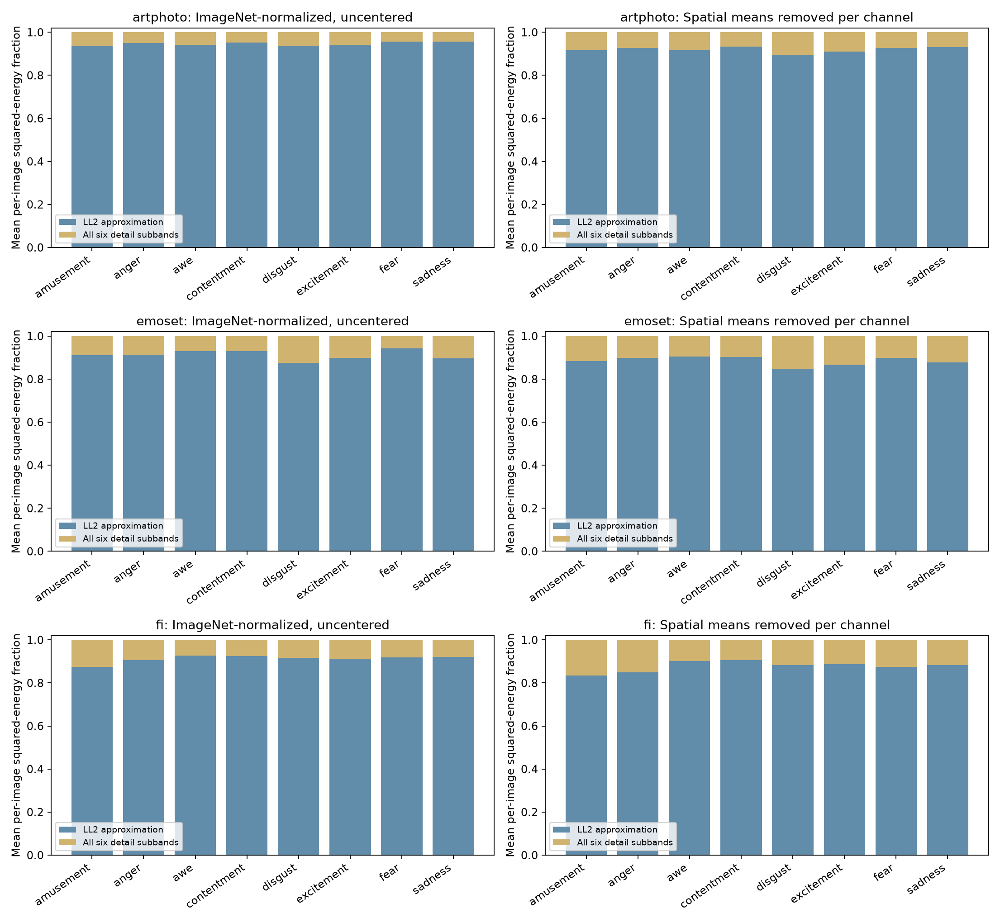
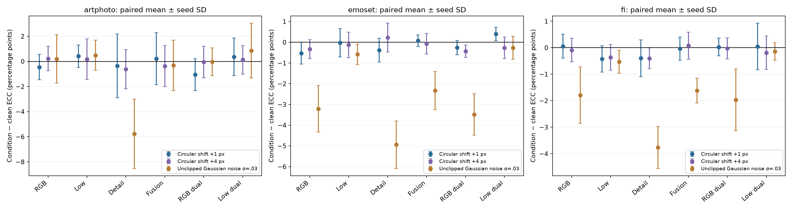

# Wavelet theory and frozen-model sensitivity diagnostics

This supplement connects exact signal-processing predictions to measured behavior. The prediction probes are fixed descriptive diagnostics; they do not select checkpoints, retune models or introduce additional significance claims.

## What the theory predicts

For two-level orthonormal Haar analysis, the reconstructed LL2 component is an orthogonal projection P onto 4×4 block constants. The signed complement is (I−P)x. They sum to x, are orthogonal, and their subband squared energies obey Parseval. LL2 reconstruction is a replicated block average, not an ideal frequency cutoff. These identities are verified on a fixed training-only sample with float64 arithmetic.

The LL2 subspace has 1/16 of the dimensions. Therefore isotropic iid zero-mean white noise has expected low-component energy fraction 1/16 and detail fraction 15/16. This is a projection-energy prediction on synthetic noise, not a claim about class information, classification accuracy or physical image SNR.

A one-pixel circular horizontal shift generally changes the decimation grid. A four-pixel circular shift commutes with P on this divisible periodic grid. Commutation of preprocessing does not imply that a strided CNN's predictions are invariant to the shift.

| Dataset | Training images audited | Largest identity residual | One-pixel commutator mean | White-noise low energy | White-noise detail energy |
|---|---:|---:|---:|---:|---:|
| artphoto | 256 | 5.99e-16 | 0.16967 | 0.062179 | 0.937821 |
| emoset | 256 | 5.34e-16 | 0.20914 | 0.062179 | 0.937821 |
| fi | 256 | 6.43e-16 | 0.19658 | 0.062179 | 0.937821 |

The largest residual mixes absolute reconstruction/block-mean residuals with dimensionless relative energy/inner-product residuals; each individual value and its units are retained in `diagnostics_summary.json`. The four-pixel commutator is one of the separately checked near-zero identity residuals.

## Where natural-image energy lies

The first panel uses the ImageNet-normalized tensor without spatial centering. The second removes each channel's spatial mean before forming energy fractions. Both are averages of per-image fractions, then summarized by class on training inputs only. The uncentered low energy includes DC/color offsets; energy concentration is not evidence that the same fraction of emotion information lies there.

| Dataset | Class | Images | Uncentered normalized LL2 energy | Spatially centered LL2 energy |
|---|---|---:|---:|---:|
| artphoto | amusement | 32 | 0.93784 | 0.91557 |
| artphoto | anger | 32 | 0.95033 | 0.92793 |
| artphoto | awe | 32 | 0.94085 | 0.91665 |
| artphoto | contentment | 32 | 0.95282 | 0.93433 |
| artphoto | disgust | 32 | 0.93730 | 0.89465 |
| artphoto | excitement | 32 | 0.94242 | 0.91077 |
| artphoto | fear | 32 | 0.95595 | 0.92697 |
| artphoto | sadness | 32 | 0.95674 | 0.93191 |
| emoset | amusement | 32 | 0.91193 | 0.88391 |
| emoset | anger | 32 | 0.91431 | 0.89921 |
| emoset | awe | 32 | 0.93094 | 0.90394 |
| emoset | contentment | 32 | 0.92912 | 0.90221 |
| emoset | disgust | 32 | 0.87456 | 0.84861 |
| emoset | excitement | 32 | 0.89895 | 0.86724 |
| emoset | fear | 32 | 0.94198 | 0.89859 |
| emoset | sadness | 32 | 0.89742 | 0.87750 |
| fi | amusement | 32 | 0.87365 | 0.83432 |
| fi | anger | 32 | 0.90495 | 0.84939 |
| fi | awe | 32 | 0.92598 | 0.90217 |
| fi | contentment | 32 | 0.92456 | 0.90679 |
| fi | disgust | 32 | 0.91675 | 0.88274 |
| fi | excitement | 32 | 0.91328 | 0.88631 |
| fi | fear | 32 | 0.91943 | 0.87418 |
| fi | sadness | 32 | 0.91969 | 0.88364 |

## Fixed shift and noise probes

All probes use the same validation-selected frozen model. Shifts are circular horizontal rolls after the center crop. Gaussian noise is additive iid N(0,.03²) in RGB pixel units where the nominal range is 0…1, with the CPU random generator reset to the same seed and batch order for every model. Noise is not clipped; values can leave the nominal pixel range. These probes do not represent all real-world corruptions.

Values are condition minus clean in percentage points. A negative value is a drop. ± denotes the sample standard deviation across the within-model paired seed changes, not a confidence interval or independent image-level replication.

| Dataset | Method | Condition | ECC change | ACC change | ACC2 change |
|---|---|---|---:|---:|---:|
| artphoto | RGB single | Circular shift +1 px | -0.450 ± 1.010 | -0.938 ± 1.108 | +0.391 ± 1.858 |
| artphoto | RGB single | Circular shift +4 px | +0.224 ± 0.971 | -0.156 ± 1.822 | +1.172 ± 1.313 |
| artphoto | RGB single | Unclipped Gaussian noise σ=.03 | +0.203 ± 1.923 | -0.938 ± 2.969 | +3.672 ± 2.702 |
| artphoto | Approximation only | Circular shift +1 px | +0.413 ± 0.884 | +0.625 ± 0.945 | +0.547 ± 0.970 |
| artphoto | Approximation only | Circular shift +4 px | +0.181 ± 1.615 | +0.938 ± 2.032 | -0.469 ± 2.472 |
| artphoto | Approximation only | Unclipped Gaussian noise σ=.03 | +0.487 ± 1.197 | +0.781 ± 1.447 | -0.234 ± 2.586 |
| artphoto | Details only | Circular shift +1 px | -0.355 ± 2.540 | -0.703 ± 3.229 | +0.156 ± 2.561 |
| artphoto | Details only | Circular shift +4 px | -0.623 ± 1.562 | -1.172 ± 2.227 | +0.391 ± 2.189 |
| artphoto | Details only | Unclipped Gaussian noise σ=.03 | -5.766 ± 2.764 | -7.422 ± 3.463 | -2.266 ± 3.373 |
| artphoto | Approximation + details | Circular shift +1 px | +0.218 ± 2.067 | +0.547 ± 2.640 | -0.625 ± 2.988 |
| artphoto | Approximation + details | Circular shift +4 px | -0.383 ± 1.643 | +0.234 ± 2.239 | -2.109 ± 2.058 |
| artphoto | Approximation + details | Unclipped Gaussian noise σ=.03 | -0.309 ± 2.006 | -0.781 ± 2.729 | +1.406 ± 2.869 |
| artphoto | RGB + RGB control | Circular shift +1 px | -1.054 ± 1.272 | -1.562 ± 1.417 | -0.156 ± 2.025 |
| artphoto | RGB + RGB control | Circular shift +4 px | -0.043 ± 1.254 | -0.391 ± 1.529 | +1.016 ± 1.975 |
| artphoto | RGB + RGB control | Unclipped Gaussian noise σ=.03 | -0.029 ± 1.100 | -1.094 ± 1.882 | +3.672 ± 1.313 |
| artphoto | Approximation + approximation control | Circular shift +1 px | +0.361 ± 1.493 | +0.391 ± 1.454 | +0.625 ± 2.588 |
| artphoto | Approximation + approximation control | Circular shift +4 px | +0.128 ± 1.144 | +0.313 ± 1.377 | +0.156 ± 1.043 |
| artphoto | Approximation + approximation control | Unclipped Gaussian noise σ=.03 | +0.860 ± 2.185 | +0.625 ± 2.478 | +1.094 ± 2.449 |
| emoset | RGB single | Circular shift +1 px | -0.524 ± 0.531 | -0.641 ± 0.658 | -0.578 ± 0.551 |
| emoset | RGB single | Circular shift +4 px | -0.329 ± 0.463 | -0.352 ± 0.598 | -0.461 ± 0.458 |
| emoset | RGB single | Unclipped Gaussian noise σ=.03 | -3.206 ± 1.122 | -3.648 ± 1.273 | -4.406 ± 1.545 |
| emoset | Approximation only | Circular shift +1 px | -0.020 ± 0.687 | -0.008 ± 0.829 | -0.008 ± 0.943 |
| emoset | Approximation only | Circular shift +4 px | -0.126 ± 0.610 | -0.062 ± 0.885 | -0.297 ± 0.788 |
| emoset | Approximation only | Unclipped Gaussian noise σ=.03 | -0.578 ± 0.491 | -0.797 ± 0.605 | -0.445 ± 0.455 |
| emoset | Details only | Circular shift +1 px | -0.376 ± 0.570 | -0.586 ± 0.742 | -0.039 ± 0.799 |
| emoset | Details only | Circular shift +4 px | +0.225 ± 0.698 | +0.273 ± 0.908 | +0.320 ± 0.950 |
| emoset | Details only | Unclipped Gaussian noise σ=.03 | -4.943 ± 1.148 | -6.922 ± 1.354 | -4.164 ± 1.484 |
| emoset | Approximation + details | Circular shift +1 px | +0.076 ± 0.278 | +0.039 ± 0.474 | +0.242 ± 0.720 |
| emoset | Approximation + details | Circular shift +4 px | -0.073 ± 0.497 | -0.180 ± 0.647 | +0.180 ± 0.725 |
| emoset | Approximation + details | Unclipped Gaussian noise σ=.03 | -2.326 ± 0.917 | -3.094 ± 1.387 | -2.000 ± 1.033 |
| emoset | RGB + RGB control | Circular shift +1 px | -0.256 ± 0.348 | -0.234 ± 0.455 | -0.438 ± 0.371 |
| emoset | RGB + RGB control | Circular shift +4 px | -0.431 ± 0.297 | -0.523 ± 0.347 | -0.500 ± 0.320 |
| emoset | RGB + RGB control | Unclipped Gaussian noise σ=.03 | -3.480 ± 1.002 | -3.984 ± 1.232 | -4.672 ± 1.428 |
| emoset | Approximation + approximation control | Circular shift +1 px | +0.404 ± 0.324 | +0.625 ± 0.515 | +0.172 ± 0.267 |
| emoset | Approximation + approximation control | Circular shift +4 px | -0.270 ± 0.518 | -0.219 ± 0.706 | -0.266 ± 0.781 |
| emoset | Approximation + approximation control | Unclipped Gaussian noise σ=.03 | -0.267 ± 0.552 | -0.453 ± 0.667 | -0.086 ± 0.636 |
| fi | RGB single | Circular shift +1 px | +0.054 ± 0.450 | -0.031 ± 0.615 | +0.039 ± 0.464 |
| fi | RGB single | Circular shift +4 px | -0.092 ± 0.442 | -0.204 ± 0.554 | -0.204 ± 0.441 |
| fi | RGB single | Unclipped Gaussian noise σ=.03 | -1.790 ± 1.063 | -2.597 ± 1.207 | -1.389 ± 1.502 |
| fi | Approximation only | Circular shift +1 px | -0.422 ± 0.496 | -0.628 ± 0.495 | -0.282 ± 0.513 |
| fi | Approximation only | Circular shift +4 px | -0.367 ± 0.487 | -0.683 ± 0.430 | +0.118 ± 0.839 |
| fi | Approximation only | Unclipped Gaussian noise σ=.03 | -0.535 ± 0.437 | -0.855 ± 0.649 | -0.510 ± 0.644 |
| fi | Details only | Circular shift +1 px | -0.398 ± 0.695 | -0.573 ± 0.926 | -0.275 ± 0.857 |
| fi | Details only | Circular shift +4 px | -0.401 ± 0.396 | -0.628 ± 0.700 | +0.039 ± 0.574 |
| fi | Details only | Unclipped Gaussian noise σ=.03 | -3.767 ± 0.794 | -5.438 ± 0.846 | -2.770 ± 0.937 |
| fi | Approximation + details | Circular shift +1 px | -0.033 ± 0.438 | -0.047 ± 0.682 | -0.086 ± 0.520 |
| fi | Approximation + details | Circular shift +4 px | +0.076 ± 0.512 | +0.071 ± 0.655 | +0.165 ± 0.668 |
| fi | Approximation + details | Unclipped Gaussian noise σ=.03 | -1.619 ± 0.463 | -2.299 ± 0.740 | -1.436 ± 0.617 |
| fi | RGB + RGB control | Circular shift +1 px | +0.027 ± 0.336 | +0.024 ± 0.454 | +0.055 ± 0.323 |
| fi | RGB + RGB control | Circular shift +4 px | -0.024 ± 0.398 | -0.047 ± 0.547 | +0.008 ± 0.395 |
| fi | RGB + RGB control | Unclipped Gaussian noise σ=.03 | -1.972 ± 1.165 | -2.770 ± 1.469 | -1.703 ± 1.198 |
| fi | Approximation + approximation control | Circular shift +1 px | +0.045 ± 0.880 | +0.039 ± 1.054 | +0.220 ± 0.900 |
| fi | Approximation + approximation control | Circular shift +4 px | -0.192 ± 0.632 | -0.314 ± 0.770 | -0.086 ± 0.430 |
| fi | Approximation + approximation control | Unclipped Gaussian noise σ=.03 | -0.139 ± 0.331 | -0.314 ± 0.393 | -0.031 ± 0.412 |

## Fusion component sensitivity

Removing detail projects the normalized tensor onto P before the fusion model, so its detail branch receives zero. Removing low uses (I−P), so its approximation branch receives zero up to arithmetic roundoff. Zero here is in normalized component coordinates; it does not mean setting a raw RGB image to black. These are out-of-distribution, nonlinear branch sensitivity probes. Drops cannot be interpreted as a causal information attribution, and the two drops need not add to the clean score.

| Dataset | Intervention | ECC change | ACC change | ACC2 change |
|---|---|---:|---:|---:|
| artphoto | Fusion: detail zeroed | -4.434 ± 2.210 | -5.938 ± 3.256 | -4.297 ± 2.349 |
| artphoto | Fusion: low zeroed | -4.487 ± 1.749 | -4.297 ± 2.465 | -7.891 ± 3.704 |
| emoset | Fusion: detail zeroed | -6.194 ± 0.970 | -8.289 ± 1.364 | -4.914 ± 1.080 |
| emoset | Fusion: low zeroed | -13.971 ± 2.290 | -19.484 ± 2.940 | -11.727 ± 3.276 |
| fi | Fusion: detail zeroed | -7.672 ± 2.349 | -10.209 ± 2.997 | -7.164 ± 2.783 |
| fi | Fusion: low zeroed | -13.215 ± 3.907 | -16.973 ± 4.676 | -14.626 ± 4.146 |

## Verification scope

Verified the declared hashes and independently recomputed metrics for 624 test-condition arrays. Also checked complete bitwise-exact validation replay records for 144 models and independently recomputed their saved validation-array metrics. These arrays include the clean arrays already checked in the main report; overlapping counts must not be added as independent evidence.

The CPU supplement checks that every planned method/seed/condition appears exactly once, every replay record reports zero probability difference, class/split identities agree with the pinned CSVs, and clean condition metrics agree with each run's final test record. It also checks protocol/executed-source fingerprints, training sample indices, per-image subband energy partitions, class means, noise-energy accounting and identity residual bounds.

The actual checkpoint reloading and validation inference replay occurred in the GPU evaluation stage. This CPU report validates that recorded audit and the saved predictions; it does not independently rerun network inference. Test conditions were generated from those loaded selected checkpoints. No test replay beyond the explicitly recorded validation replay is claimed.

Results remain conditional on the existing fixed splits, ImageNet initialization, optimizer and short training budget. Training seeds are not independent dataset samples, and ArtPhoto is small. Detail-only results can be affected by ImageNet input adaptation and source JPEG/resizing artifacts. Haar LL2 is exactly a block-average projection, so the experiment does not establish that Haar uniquely outperforms other filters or discover a human visual mechanism.

Machine-readable outputs: `diagnostics_summary.json`, `diagnostics_verification.json`, `condition_results.csv`. Regenerate with `python scripts/report_wavelet_diagnostics.py --out outputs/wavelet_study` after the evaluation stage completes.

