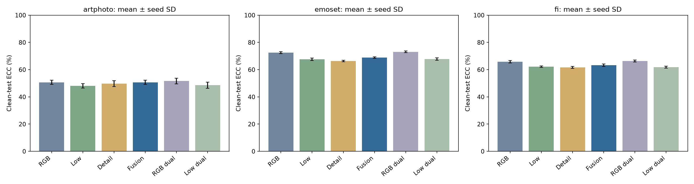
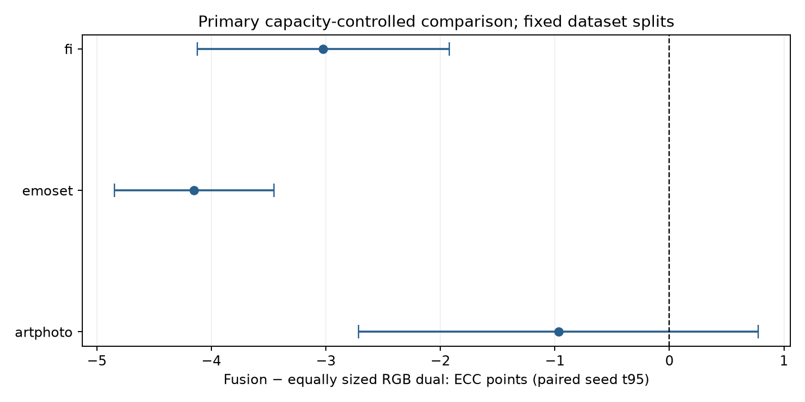
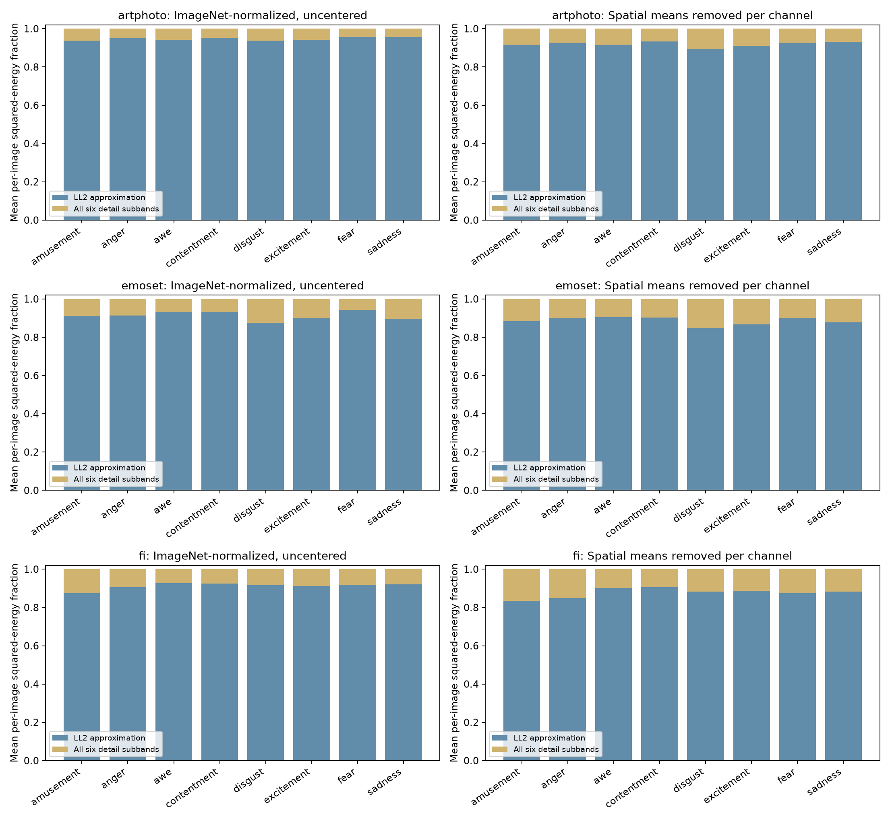
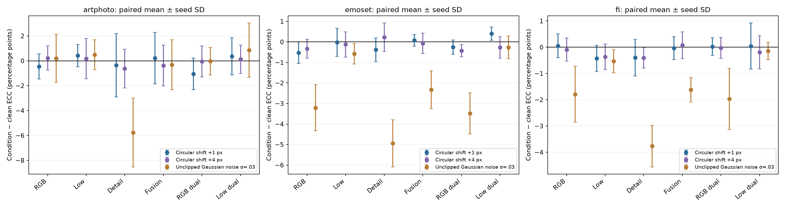

# Completed wavelet experiment: findings and signal-processing connection

The implemented two-level Haar fusion did **not** improve recognition. Against
an equally sized RGB+RGB network, it lost ECC on every one of eight paired seeds
on both FI and the EmoSet subset. ArtPhoto was inconclusive. This is stronger
evidence than a small favorable mean from a single seed: the primary effects on
the two larger prepared datasets are consistently negative under this protocol.

The signal-processing implementation passed its mathematical and numerical
checks. Those identities and the recognition hypothesis are different claims.
Perfect reconstruction and noise suppression by a projection do not imply that
splitting a pretrained classifier's inputs improves its accuracy.

## What was implemented and run

The opt-in module is `src/ecc/wavelets.py`. It implements differentiable,
orthonormal two-dimensional Haar analysis/synthesis, multilevel pyramids,
same-size subband reconstructions, and six controlled classification models:

| Model | Inputs | Trainable parameters |
|---|---|---:|
| RGB | Normalized photograph | 11,180,616 |
| Low | Reconstructed LL2 | 11,180,616 |
| Detail | All signed level-one/two details | 11,180,616 |
| Fusion | Independent low and detail towers | 22,361,224 |
| RGB dual | Independent RGB and RGB towers | 22,361,224 |
| Low dual | Independent low and low towers | 22,361,224 |

All methods use cross entropy, ImageNet-pretrained ResNet18, AdamW lr1e-4,
weight decay1e-4, batch64, and 12 epochs. The two towers are independent parameter
copies. Paired antisymmetric classifier perturbations break duplicate-tower
gradient symmetry while preserving initial duplicate-RGB logits in real
arithmetic. Methods share starting weights wherever shapes agree and exactly
the same shuffled examples, crops and flips within each seed.

There are eight fresh seeds15-22, six methods, and three datasets: **144 models**.
All training completed before any new test evaluation. Validation ECC alone
selected the checkpoint, retaining the earliest exact tie. Each GPU task ran
sequentially. All 91,008 planned optimizer steps completed; AMP skipped zero.
The sum of recorded per-model training times is 138.7 minutes. Eleven of144
selected checkpoints are at the epoch12 boundary; longer adaptation remains a
possible future question, without selectively extending models after test.

| Prepared split | Train | Validation | Test |
|---|---:|---:|---:|
| FI | 4,777 | 800 | 1,593 |
| EmoSet subset | 4,800 | 800 | 1,600 |
| ArtPhoto | 468 | 155 | 160 |

These reuse the previously cleaned, audited splits. FI comes from a public
mirror with unavailable-photo placeholders removed; the EmoSet subset is capped
from available shards; ArtPhoto is small. These are not canonical full benchmark
results. The test splits were inspected in earlier studies, so this is a newly
locked exploratory extension, not pristine confirmatory evidence.

## Recognition outcomes

Mean test ECC percentages over eight seeds; contrasts below are percentage points:

| Dataset | RGB | Low | Detail | Fusion | RGB dual | Low dual |
|---|---:|---:|---:|---:|---:|---:|
| FI | 65.834 | 62.139 | 61.586 | 63.309 | 66.332 | 61.764 |
| EmoSet subset | 72.422 | 67.663 | 66.388 | 68.953 | 73.104 | 67.795 |
| ArtPhoto | 50.709 | 48.075 | 49.724 | 50.657 | 51.625 | 48.578 |

The primary contrast is fusion minus RGB dual. Intervals below retain paired
training seeds as the replication units. The crossed interval also resamples
shared class-stratified test images. Neither includes new training-data splits.

| Dataset | ECC difference | Seed t95 | Crossed seed/image95 | Fusion wins | Holm-adjusted exact p |
|---|---:|---|---|---:|---:|
| FI | -3.023 | [-4.124, -1.922] | [-4.385, -1.737] | 0/8 | 0.02344 |
| EmoSet subset | -4.151 | [-4.846, -3.455] | [-5.299, -3.005] | 0/8 | 0.02344 |
| ArtPhoto | -0.968 | [-2.713, +0.778] | [-4.244, +2.517] | 2/8 | 0.25000 |

The FI/EmoSet result supports a disadvantage for this particular representation
allocation, pretraining and budget under the stated inference assumptions. It
does not prove all wavelet architectures fail. ArtPhoto's broad interval does not
establish equivalence. The Student intervals assume approximately normal seed
differences; exact sign flips assume within-pair exchangeability/sign symmetry.

Fusion also lost to single RGB by2.525 ECC points on FI and3.469 on EmoSet.
Relative to low+low it gained1.545,1.159 and2.079 points on FI, EmoSet and ArtPhoto,
respectively. Those latter contrasts suggest complementary detail can help
relative to duplicating coarse input, while RGB has the higher observed mean and primary evidence on FI/EmoSet favors it over fusion. The
comparisons with low+low are descriptive secondary estimates.

The secondary Holm family contains12 comparisons. With eight pairs, the minimum
ordinary two-sided exact sign-flip p is2/256=.0078125; it cannot pass the first
secondary Holm threshold .05/12. Failure of that secondary family to reject is
therefore partly imposed by discrete test resolution and is not evidence that
the secondary effects are absent. The primary three-comparison family can
reject, as it did for the negative FI and EmoSet effects.

## Direct predictions from signal-processing theory

For normalized input z, orthonormal Haar gives low=Pz and detail=(I-P)z. At
two levels P is the orthogonal projection onto4x4 block constants. Consequently
low+detail=z, their inner product is zero, and the sum of subband energies equals
input energy. Fusion adds no information; it tests representation and
optimization. For Haar, the low reconstruction is **exactly block averaging**,
so this experiment cannot claim that Haar uniquely beats generic averaging.

On256 fixed training-only images per dataset, float64 reconstruction, band
summation, block-mean equivalence and four-pixel commutation had zero measured
absolute residual. The largest relative Parseval error across the three samples
was6.43e-16. This audits the identities at numerical precision, rather than
assuming that a function named DWT implements them correctly.

For iid white noise with covariance sigma²I, E||Pn||²=sigma²tr(P). Each4x4 block
has16 dimensions and P has rank1, so expected noise-energy fractions are1/16
low and15/16 detail. The fixed synthetic-noise realization measured **6.2179%**
and **93.7821%**, close to6.25%/93.75%. The same noise realization is reused
across dataset audits; these are not three independent noise replications.

After removing each channel's spatial mean, natural training images retained
87.74% of energy in low on FI,88.52% on EmoSet and91.98% on ArtPhoto. These are
averages of per-image fractions on the diagnostic sample. The residual has less
energy but can still carry discriminative information; energy is not a measure
of emotion information.

Critical sampling predicts grid sensitivity. The mean normalized commutator
norm ||P(T1z)-T1(Pz)||/||z|| was.1966 on FI,.2091 on EmoSet and.1697 on ArtPhoto.
For a four-pixel circular shift it was zero. These are preprocessing identities,
not classifier accuracy guarantees. The shift-variant projection has no single
scalar LTI transfer function on the original pixel grid. Complete Haar
analysis/synthesis cancels aliases; discarding detail does not retain that
complete-bank cancellation or eliminate later CNN downsampling artifacts.

## Noise robustness is a tradeoff, not a recovered accuracy gain

For fixed unclipped Gaussian RGB noise sigma=.03 in0..1 pixel units:

| Dataset | RGB clean ECC | RGB noisy ECC | Low clean ECC | Low noisy ECC |
|---|---:|---:|---:|---:|
| FI | 65.834 | 64.043 | 62.139 | 61.604 |
| EmoSet subset | 72.422 | 69.216 | 67.663 | 67.084 |

Low-only ECC fell less:0.535 versus1.790 points on FI, and0.578 versus3.206 on
EmoSet. This is consistent with averaging suppressing independent noise, while
absolute noisy ECC still favored RGB. A smaller drop from a lower clean
baseline is not a better final classifier. These are fixed descriptive probes,
not additional significance claims or evidence about every real corruption.

For fusion, removing detail reduced ECC by7.672 points on FI and6.194 on EmoSet;
removing low reduced it by13.215 and13.971. Both components influence predictions.
Zeroing components changes the input distribution; these drops are not causal
information shares, need not add, and do not measure human perception.

Fusion also costs more: average training was106.7 seconds per FI model versus
55.2 for RGB and100.7 for RGB dual. EmoSet was106.6 versus55.4 and102.1 seconds.
The implemented full-resolution branches claim no coefficient-domain speedup.

## Verification and reproducibility

- Every one of15,153 prepared source images was independently compared with its
  cached input row. All nine input caches and split manifests are pinned by hash.
- All144 selected checkpoints replayed their saved validation probabilities
  bit-for-bit, with maximum probability difference0. Test arrays were generated
  from these loaded checkpoints; a separate bitwise test-replay pass is not claimed.
- All624 test-condition arrays and144 validation arrays were independently
  checked for identities, probability validity and recomputed metrics. These
  **768 unique arrays** include the288 clean arrays counted in the main report.
- Protocol, executed-source snapshots, initialization, augmentation, full epoch
  histories, checkpoint selection, optimizer accounting and available checkpoint
  hashes all passed. Raw photographs, caches and weights remain local.

The full unit suite and the final package audit are recorded separately with
their exact counts and hashes. Start with [the clean-model report](REPORT.html),
[noise/shift diagnostics](DIAGNOSTICS.html), [theory and viva](THEORY_AND_VIVA.md),
and [the locked study plan](STUDY_PLAN.md).

## What to tell the examiner

“We derived an orthogonal coarse/detail decomposition from a two-level Haar
filter bank, verified perfect reconstruction and Parseval, predicted the white-
noise energy split from projection rank, and tested the grid sensitivity caused
by critical sampling. Then we isolated representation from extra model capacity
using matched dual controls and eight paired training seeds. The proposed fusion
did not improve clean recognition, although coarse projection reduced sensitivity
to the specified noise. This establishes an explicit noise/detail tradeoff and
the limits of the tested representation, rather than an unsupported gain.”

The next mechanism-driven study could preserve the RGB pathway with an
identity-initialized learned subband residual, or compare critically sampled
against stationary/cycle-spun decompositions with matched compute. Those are
future hypotheses, not completed results or guaranteed improvements. They require
a new plan before evaluation. ImageNet adaptation to signed detail, JPEG/resize
history, near duplicates, fixed splits and short training remain limitations.
