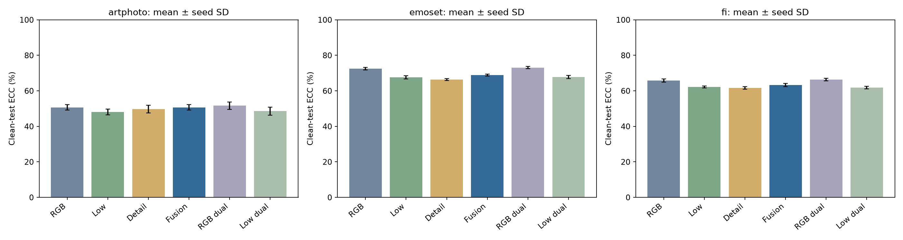
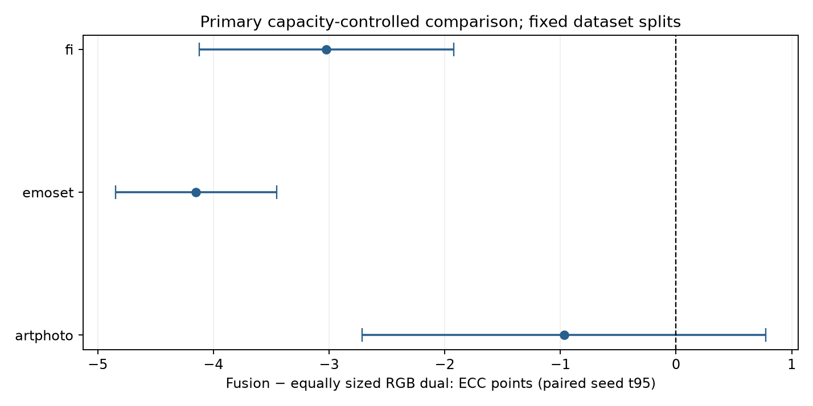

# Wavelet multiresolution emotion-recognition experiment

This is an opt-in experiment on fixed real-image splits. It evaluates a spatial signal-processing inductive bias; it does not establish a human visual mechanism or reproduce the complete NeurIPS benchmark.

## What is being tested

A two-level orthonormal Haar filter bank separates each normalized 160×160 RGB image into its same-size LL2 reconstruction and all signed details. LL2 reconstruction equals a replicated 4×4 block mean. Analysis and synthesis reconstruct the original input, and squared subband energies sum to input energy (Parseval). The low and detail projections are orthogonal and sum to the original image. Fusion therefore adds no information; any benefit must come from how the model uses the representation.

All six methods use cross-entropy. Approximation-only and details-only models identify which components support recognition. The main comparison is approximation+detail fusion against a parameter-matched RGB+RGB network. Approximation+approximation controls for two-branch capacity without complementary details. Dual classifier blocks use matched antisymmetric initialization perturbations to avoid identical RGB towers remaining identical during training.

No per-image min-max scaling or clipping is applied to signed details. Decomposition acts on ImageNet-normalized input z: low=Pz and detail=(I−P)z; this avoids adding an artificial RGB mean to the detail branch. Both towers see full-size reconstructed components, so this design does not claim the compute savings of a coefficient-domain network.

A decimated Haar projection is shift-variant: a one-pixel shift changes the block alignment. Retaining only LL2 is not an ideal low-pass filter, and this architecture does not remove aliasing from later CNN downsampling. The experiment is distinct from WaveCNet, WTConv and scattering networks.

## Data and training budget

All models in a dataset use the same fixed split, paired pretrained backbone/head initialization and precomputed crop/flip/minibatch plans. Checkpoints use only validation ECC. No inspected test result changes the training settings or the planned comparisons.

| Dataset | Train / validation / test images | Epochs | Batch | Paired seeds |
|---|---|---:|---:|---|
| artphoto | 468 / 155 / 160 | 12 | 64 | 15, 16, 17, 18, 19, 20, 21, 22 |
| emoset | 4,800 / 800 / 1,600 | 12 | 64 | 15, 16, 17, 18, 19, 20, 21, 22 |
| fi | 4,777 / 800 / 1,593 | 12 | 64 | 15, 16, 17, 18, 19, 20, 21, 22 |

Dataset preparation records, source/archive fingerprints, class counts and split provenance are preserved in `dataset_provenance.json`. These prepared subsets and fixed splits must not be presented as the canonical full FI, ArtPhoto or EmoSet benchmark protocols.

## Clean-test results

Numbers below are averages across paired independently trained seeds; ± denotes the sample standard deviation across seeds. ACC2 measures polarity accuracy. EMC is conditional on the model's changing subset of mistakes and is not a physical signal-to-noise ratio.

| Dataset | Method | Seeds | ACC | ECC | ACC2 | EMC | Brier | Parameters |
|---|---|---:|---:|---:|---:|---:|---:|---:|
| artphoto | RGB single | 8 | 31.406 ± 1.822 | 50.709 ± 1.567 | 67.188 ± 2.893 | 46.063 ± 1.978 | 0.87185 | 11,180,616 |
| artphoto | Approximation only | 8 | 26.797 ± 2.176 | 48.075 ± 1.694 | 65.781 ± 1.447 | 48.649 ± 1.854 | 0.92891 | 11,180,616 |
| artphoto | Details only | 8 | 30.312 ± 2.522 | 49.724 ± 2.197 | 64.453 ± 2.325 | 45.824 ± 2.147 | 0.90416 | 11,180,616 |
| artphoto | Approximation + details | 8 | 30.469 ± 2.053 | 50.657 ± 1.561 | 67.734 ± 2.058 | 48.552 ± 1.324 | 0.87021 | 22,361,224 |
| artphoto | RGB + RGB control | 8 | 32.109 ± 1.946 | 51.625 ± 2.029 | 67.734 ± 2.499 | 47.730 ± 2.738 | 0.87431 | 22,361,224 |
| artphoto | Approximation + approximation control | 8 | 28.203 ± 2.902 | 48.578 ± 2.270 | 65.234 ± 3.389 | 47.031 ± 2.932 | 0.89048 | 22,361,224 |
| emoset | RGB single | 8 | 60.258 ± 1.067 | 72.422 ± 0.722 | 85.484 ± 0.642 | 51.262 ± 1.220 | 0.55858 | 11,180,616 |
| emoset | Approximation only | 8 | 53.742 ± 1.241 | 67.663 ± 0.932 | 81.852 ± 0.976 | 50.202 ± 1.306 | 0.62745 | 11,180,616 |
| emoset | Details only | 8 | 52.344 ± 0.698 | 66.388 ± 0.534 | 80.453 ± 0.937 | 48.827 ± 0.898 | 0.65057 | 11,180,616 |
| emoset | Approximation + details | 8 | 55.547 ± 0.611 | 68.953 ± 0.529 | 82.680 ± 0.864 | 50.396 ± 1.063 | 0.63027 | 22,361,224 |
| emoset | RGB + RGB control | 8 | 61.156 ± 0.878 | 73.104 ± 0.675 | 86.133 ± 0.849 | 51.539 ± 1.188 | 0.56952 | 22,361,224 |
| emoset | Approximation + approximation control | 8 | 53.945 ± 1.064 | 67.795 ± 0.867 | 82.031 ± 0.540 | 50.158 ± 1.229 | 0.64879 | 22,361,224 |
| fi | RGB single | 8 | 52.150 ± 1.168 | 65.834 ± 0.848 | 80.830 ± 0.601 | 46.363 ± 0.895 | 0.69165 | 11,180,616 |
| fi | Approximation only | 8 | 47.089 ± 0.704 | 62.139 ± 0.513 | 78.468 ± 0.697 | 45.980 ± 1.121 | 0.68493 | 11,180,616 |
| fi | Details only | 8 | 46.390 ± 1.010 | 61.586 ± 0.706 | 77.566 ± 0.978 | 45.835 ± 1.148 | 0.71724 | 11,180,616 |
| fi | Approximation + details | 8 | 48.446 ± 1.195 | 63.309 ± 0.908 | 79.229 ± 0.935 | 46.948 ± 0.662 | 0.69543 | 22,361,224 |
| fi | RGB + RGB control | 8 | 52.723 ± 0.854 | 66.332 ± 0.661 | 81.238 ± 0.507 | 46.777 ± 0.681 | 0.65456 | 22,361,224 |
| fi | Approximation + approximation control | 8 | 46.563 ± 1.014 | 61.764 ± 0.727 | 77.723 ± 0.666 | 46.115 ± 0.772 | 0.73417 | 22,361,224 |

## Primary comparison

The predeclared primary contrast is fusion minus RGB dual ECC, with one contrast per dataset in a single Holm family. Positive values favor fusion. The Student interval uses paired seed differences; the crossed bootstrap additionally resamples shared class-stratified test images, preserving the pairing across methods and seeds.

| Dataset | ECC difference | Paired seed t95 | Crossed seed/image 95% | Wins | Exact sign-flip p | Holm p |
|---|---:|---|---|---:|---:|---:|
| artphoto | -0.968 | [-2.713, +0.778] | [-4.244, +2.517] | 2/8 | 0.25 | 0.25 |
| emoset | -4.151 | [-4.846, -3.455] | [-5.299, -3.005] | 0/8 | 0.007812 | 0.02344 |
| fi | -3.023 | [-4.124, -1.922] | [-4.385, -1.737] | 0/8 | 0.007812 | 0.02344 |

**artphoto:** The observed decrease is 0.968 ECC points. The seed t95 interval includes zero; the direction is uncertain. The ECC sign-flip comparison does not reject the within-seed exchangeability null after its predeclared Holm correction (p=0.25). A non-rejection does not establish equality or a zero effect; fixed-split seed uncertainty does not include new training datasets.

**emoset:** The observed decrease is 4.151 ECC points. The seed t95 interval excludes zero under its normality assumptions. The ECC sign-flip comparison rejects the within-seed exchangeability null after its predeclared Holm correction (p=0.02344). A non-rejection does not establish equality or a zero effect; fixed-split seed uncertainty does not include new training datasets.

**fi:** The observed decrease is 3.023 ECC points. The seed t95 interval excludes zero under its normality assumptions. The ECC sign-flip comparison rejects the within-seed exchangeability null after its predeclared Holm correction (p=0.02344). A non-rejection does not establish equality or a zero effect; fixed-split seed uncertainty does not include new training datasets.

## Secondary contrasts

Four predeclared ECC contrasts per dataset form a separate Holm family. They explain the representation rather than replacing an unsuccessful primary comparison. ACC, ACC2, EMC, Brier, GSEE and macro-ECC are descriptive secondary metrics with no additional success claims.

| Dataset | Contrast | ECC difference | Paired seed t95 | Holm p |
|---|---|---:|---|---:|
| artphoto | wavelet_fusion − rgb | -0.052 | [-1.616, +1.512] | 0.9609 |
| artphoto | wavelet_fusion − low_dual | +2.079 | [+0.202, +3.956] | 0.1406 |
| artphoto | low − rgb | -2.633 | [-3.242, -2.025] | 0.09375 |
| artphoto | detail − rgb | -0.984 | [-2.585, +0.616] | 0.3125 |
| emoset | wavelet_fusion − rgb | -3.469 | [-4.153, -2.784] | 0.09375 |
| emoset | wavelet_fusion − low_dual | +1.159 | [+0.342, +1.975] | 0.09375 |
| emoset | low − rgb | -4.759 | [-5.760, -3.759] | 0.09375 |
| emoset | detail − rgb | -6.034 | [-6.812, -5.255] | 0.09375 |
| fi | wavelet_fusion − rgb | -2.525 | [-3.111, -1.938] | 0.09375 |
| fi | wavelet_fusion − low_dual | +1.545 | [+1.101, +1.989] | 0.09375 |
| fi | low − rgb | -3.695 | [-4.710, -2.679] | 0.09375 |
| fi | detail − rgb | -4.248 | [-5.316, -3.180] | 0.09375 |

## Verification and limits

The report independently checks protocol, study-plan and executed-source hashes; split manifests and cached input arrays; shared initialization and augmentation; full epoch histories; earliest validation-ECC checkpoint selection; and every saved validation/test probability array with metric recomputation. Available checkpoint files are hash-checked. This report itself does not replay model inference or compare source-image pixels; separate audits are identified explicitly when present.

Verified 144 trained models and 288 clean probability arrays. Dataset splits are analyzed separately; their training seeds and test images are not pooled into a fictitious larger replication count.

The same existing test splits have been inspected in earlier experiments, so this is a transparently planned extension rather than a pristine unseen-benchmark confirmation. Training-seed uncertainty is conditional on the chosen data split, pretraining, optimizer and epoch budget. A small seed study does not establish a population-wide effect. Non-significance is not equivalence, and a positive ECC difference does not prove psychological plausibility.

Haar multiresolution theory motivates the partition and measurable energy/shift predictions; it does not guarantee emotion-recognition gains. Gaussian-noise and shift/branch-ablation diagnostics, if produced separately, are descriptive checks and cannot be used to retune the reported models.

## Reproduction artifacts

Use the study runner for sequential single-GPU training and its evaluation/replay stages. Regenerate this report with `python scripts/report_wavelet_study.py --out outputs/wavelet_study --bootstrap 1500`. The package contains saved probabilities, histories, protocol/source fingerprints and tables; raw photographs, caches and model weights remain local.

Primary theory: [Mallat, A Theory for Multiresolution Signal Decomposition (1989)](https://www.di.ens.fr/~mallat/papiers/MallatTheory89.pdf). Related architectures, not reproduced here: [WaveCNet](https://arxiv.org/abs/2107.13335), [WTConv](https://arxiv.org/abs/2407.05848).

Separate audit/diagnostic artifacts found and fingerprinted:

- `input_verification.json` (SHA256 `e4d31da8ee40cbeb7912acdb781feea4b708e11b0335a6904e51c43044533b20`); inspect its own status and scope before claiming its checks passed.
