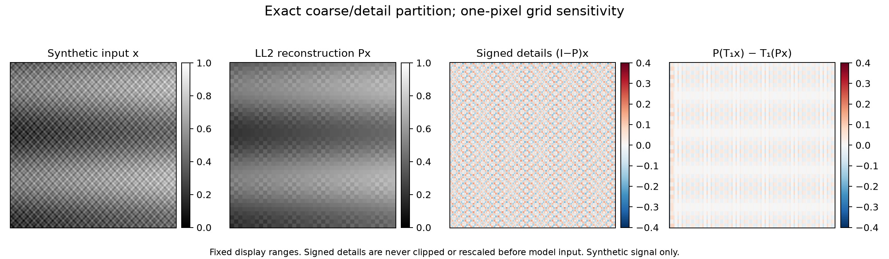
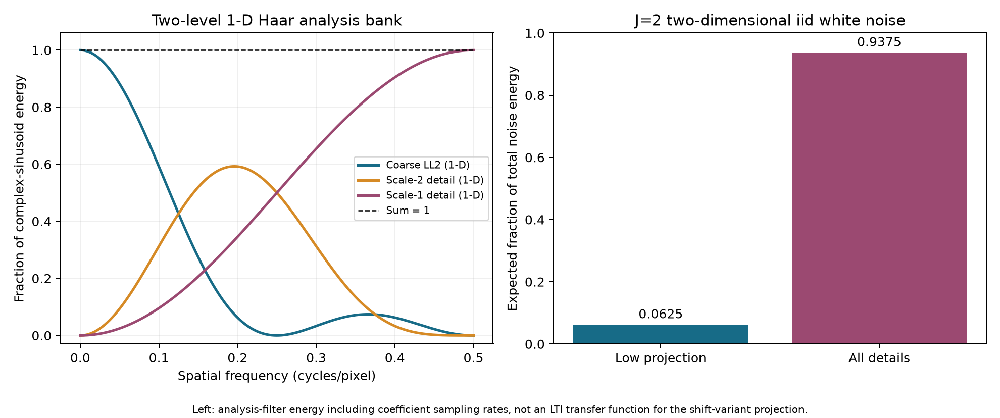

# A wavelet experiment for visual emotion recognition

The first figure uses a synthetic signal; display ranges are fixed. The second
shows sampling-rate-weighted analysis energies for complex sinusoids in one
dimension and the rank-derived white-noise prediction in two dimensions. It is
not an LTI frequency response for the block projection.

## What this project asks

A visual emotion classifier takes a photograph and predicts one of eight dataset labels: amusement, awe, contentment, excitement, anger, disgust, fear and sadness. The label describes the image's annotated emotional association. Predicting that annotation does not directly measure a person's internal emotional state.

Ordinary accuracy gives credit only to an exact label match. The original *To Err Like Human* project also evaluates the severity of mistakes through an emotion-distance matrix. If a true class is `i`, the predicted class is `j`, and the paper's distance is `W[i,j]`, an image contributes `1/W[i,j]` to Emotion Confusion Confidence, or ECC. The diagonal is one, so correct predictions receive full credit. Emotionally nearer mistakes receive more credit than distant mistakes. We report ECC as a percentage:

$$
\mathrm{ECC}=\frac{100}{N}\sum_{n=1}^{N}\frac{1}{W[y_n,\hat y_n]}.
$$

The paper also defines EMC over misclassified examples. EMC is a severity statistic on a changing set of errors; it is not physical signal-to-noise ratio. Our wavelet experiment keeps the classification task and training loss fixed and changes how the image is presented to the network. [Original NeurIPS paper](https://proceedings.neurips.cc/paper_files/paper/2024/file/f2bb120e9a2cb9c2a50921b7f865c421-Paper-Conference.pdf).

The experiment asks whether separating coarse image structure from complementary detail helps recognition beyond a network with the same capacity. The signal-processing contribution is a chain of derivation, implementation checks, controls and measurements. It does not depend on obtaining an accuracy improvement.

## Start with a signal, not an architecture

An RGB photograph is three sampled two-dimensional signals. A pixel value varies along horizontal and vertical position. Slowly varying regions and rapid local changes can be separated using a filter bank.

For the Haar wavelet, the one-dimensional analysis filters are

$$
h_L=[1,1]/\sqrt{2},\qquad h_H=[1,-1]/\sqrt{2}.
$$

The low filter averages neighboring samples; the high filter measures their difference. Applying these filters along both image axes, followed by subsampling by two along each axis, produces four subbands. Orthogonal multiresolution analysis and its filter-bank implementation provide the foundation for this construction. [Mallat, 1989](https://www.di.ens.fr/~mallat/papiers/MallatTheory89.pdf).

We use the first band letter for filtering along rows and the second for filtering along columns. Naming the axes avoids ambiguity about whether a name refers to the filter direction or the orientation of a visible edge.

For a single color channel and a block

$$
\begin{bmatrix}a&b\\c&d\end{bmatrix},
$$

the implementation computes

$$
\begin{aligned}
LL&=(a+b+c+d)/2,\\
LH&=(a-b+c-d)/2,\\
HL&=(a+b-c-d)/2,\\
HH&=(a-b-c+d)/2.
\end{aligned}
$$

`LH` measures changes along columns, `HL` measures changes along rows, and `HH` captures a diagonal difference pattern. These coefficients retain their signs.

The factor is **one half**, not one quarter. `LL` is an orthonormal coefficient, not the block mean. The inverse transform supplies another factor of one half when reconstructing a constant block.

## Derive reconstruction and energy preservation

Write one block as `v=[a,b,c,d]ᵀ` and its coefficients as `c=Hv`, where

$$
H=\frac12
\begin{bmatrix}
1&1&1&1\\
1&-1&1&-1\\
1&1&-1&-1\\
1&-1&-1&1
\end{bmatrix}.
$$

Each row has unit length, and distinct rows have zero inner product. Therefore `HᵀH=I`. The inverse is `v=Hᵀc`, giving

$$
\begin{aligned}
a&=(LL+LH+HL+HH)/2,\\
b&=(LL-LH+HL-HH)/2,\\
c&=(LL+LH-HL-HH)/2,\\
d&=(LL-LH-HL+HH)/2.
\end{aligned}
$$

The same orthonormality proves Parseval's identity:

$$
a^2+b^2+c^2+d^2=LL^2+LH^2+HL^2+HH^2.
$$

This is an accounting identity for squared signal energy. It does not say that every subband contains equally useful classification information. A small-energy component can contain a useful discriminative cue.

## Why two levels give a 4×4 projection

At level one, we keep three detail bands and decompose `LL` again. At level two, the representation consists of `LL2`, three level-two detail bands, and the three retained level-one detail bands. The complete representation has the same number of coefficients as the original image.

An `LL2` coefficient covers one 4×4 input block. The two factors of one half give

$$
LL_2=\frac14\sum_{r=1}^{4}\sum_{s=1}^{4}x_{r,s}.
$$

Thus `LL2` is **four times the 4×4 block mean**. If every detail coefficient is set to zero and the inverse transform is applied, every reconstructed pixel in that block equals its mean.

Let `P` denote this reconstruction operation. For one 4×4 block, treated as a vector of length 16,

$$
P=\frac1{16}\mathbf1\mathbf1^\top,
\qquad P^\top=P,
\qquad P^2=P.
$$

The two model inputs are

$$
x_L=Px,\qquad x_D=(I-P)x.
$$

The detail residual contains **all** level-one and level-two details. It is not just `HH2` or an edge-magnitude image. The identities are

$$
x=x_L+x_D,
\qquad \langle x_L,x_D\rangle=0,
\qquad \|x\|_2^2=\|x_L\|_2^2+\|x_D\|_2^2.
$$

These follow because `P(I−P)=0`. Reconstruction and energy checks therefore follow directly from the theory rather than being arbitrary software tests.

For this Haar construction, low reconstruction is exactly block averaging. The experiment cannot establish that the low input is superior to an equivalent 4×4 block-average implementation: they are the same operator. Wavelet language gives us the complete orthogonal decomposition, signed detail representation and a principled way to account for energy.

## Preserve the meaning of signed detail during normalization

The pretrained network expects a fixed ImageNet affine normalization. For each channel,

$$
z=(x-\mu)/\sigma.
$$

We decompose **this normalized tensor**. Since a constant belongs to the low subspace,

$$
z_L=Pz=(Px-\mu)/\sigma,
\qquad z_D=(I-P)z=(x-Px)/\sigma.
$$

The detail branch has no extra subtraction of `μ`. Normalizing the raw detail as `(x_D−μ)/σ` would inject an artificial constant into a component designed to have zero block mean.

We retain negative values, avoid clipping, and avoid independent per-image rescaling. Absolute value would discard the direction of contrast. Clipping would change the decomposition. Per-image gain adjustment would make an image with very little detail look energetically comparable to one with abundant detail. Such transformations could be separate experiments, but they would test different hypotheses.

Fixed normalization does not make all input distributions equally easy for ImageNet pretraining. The detail-only branch has a different distribution from photographs. A weak detail-only classifier therefore cannot establish that the residual contains no emotion-related information.

## A noise prediction that can be calculated before training

Consider additive zero-mean white noise `n` with covariance `σₙ²I` in a 4×4 block. For any orthogonal projection,

$$
\mathbb E\|Pn\|^2
=\mathbb E[n^\top Pn]
=\operatorname{tr}(P\,\mathbb E[nn^\top])
=\sigma_n^2\operatorname{tr}(P).
$$

Here `P` has rank and trace one. The detail projection has rank 15. Consequently,

$$
\mathbb E\|Pn\|^2=\sigma_n^2,
\quad
\mathbb E\|(I-P)n\|^2=15\sigma_n^2,
\quad
\mathbb E\|n\|^2=16\sigma_n^2.
$$

The expected energy fractions are **1/16 in low and 15/16 in detail**. Equivalently, averaging 16 independent noise samples gives each reconstructed low pixel noise variance `σₙ²/16`. The reconstructed low noise values within a block are correlated because they share the same mean. These statements apply channel by channel; fixed channel scales change absolute energies but preserve the corresponding expected fractions.

An empirical ratio from a finite generated sample will fluctuate around the prediction. Colored or spatially correlated noise need not follow this ratio: the general expression is `tr(PΣ)` for covariance `Σ`.

This calculation predicts where white-noise energy goes. It does **not** guarantee a lower classifier error rate. Projection also changes useful signal, and the network's nonlinear decision depends on the remaining cues. Most detail dimensions are not automatically noise, and a high low-energy fraction in photographs is not proof that low is sufficient for emotion recognition.

When measuring natural-image energies, report both original normalized energy and spatially centered energy. Otherwise constant brightness or a channel offset can dominate the low fraction.

## Sampling, alias cancellation and the limits of a frequency-response story

Downsampling by two folds spectral content. In the standard one-dimensional two-channel analysis/synthesis model, the reconstructed spectrum has a desired term and an alias term:

$$
\hat X(z)=\frac12\big[G_0(z)H_0(z)+G_1(z)H_1(z)\big]X(z)
+\frac12\big[G_0(z)H_0(-z)+G_1(z)H_1(-z)\big]X(-z).
$$

A perfect-reconstruction bank selects synthesis filters so that the desired term is a gain and delay and the alias term cancels. The separable two-dimensional Haar bank implements the analogous reconstruction along both axes. Our explicit block inverse is a direct finite-dimensional verification of that property.

If the detail bands are discarded, the complete-bank cancellation argument no longer applies. What remains is the defined coarse projection. A short Haar averaging filter has broad frequency response and incomplete stopband suppression. Keeping only low coefficients does not create an ideal brick-wall low-pass filter and does not remove aliasing from the CNN's later strided layers.

There is another subtlety: the complete operation “average each fixed 4×4 block and repeat its mean” is **not a single shift-invariant convolution**. Its output depends on where the block grid begins. A single scalar LTI frequency response cannot fully describe this projection on the original sampling grid. Individual analysis filters have frequency responses; the critically sampled projection is a periodically shift-varying operation.

These distinctions motivate measuring translation sensitivity. Research on anti-aliased CNN downsampling provides related motivation, but our input decomposition is a different intervention. [Zhang, ICML 2019](https://proceedings.mlr.press/v97/zhang19a.html).

## Predict grid sensitivity with a commutator

Let `Tδ` circularly shift an image horizontally by `δ` pixels. Compare filtering after shifting with shifting after filtering:

$$
C_\delta(x)=P(T_\delta x)-T_\delta(Px).
$$

For a one-pixel shift, the signal generally crosses the block boundaries differently, so `C₁(x)` is nonzero. For a four-pixel shift on a periodic grid whose size is divisible by four, the 4×4 partition maps onto itself, so `C₄(x)=0` apart from numerical roundoff.

This gives an exact preprocessing test. It does not imply that the final classifier has invariant predictions under a four-pixel shift: the CNN still has striding, nonlinearities and boundary effects. Circular shifts are controlled mathematical probes and introduce wraparound at image boundaries; they are not identical to naturally moving a camera.

The decomposition grid starts at the top-left of the cropped, flipped training image. Every method receives the same crop and flip before decomposition. This keeps augmentation paired and makes the grid convention reproducible.

## Why six models are needed

| Model | Input to tower one | Input to tower two | Purpose |
|---|---|---|---|
| RGB single | `z` | — | Conventional baseline |
| Low single | `Pz` | — | Recognition from the coarse projection |
| Detail single | `(I−P)z` | — | Recognition from complementary signed details |
| Wavelet fusion | `Pz` | `(I−P)z` | Separate processing of the two projections |
| RGB dual | `z` | `z` | Same architecture and parameter count as fusion |
| Low dual | `Pz` | `Pz` | Same capacity without complementary detail |

All models use the same eight-class cross-entropy objective. We do not add a polarity loss or graph regularizer in this study, because then a change in supervision could explain a difference attributed to the image decomposition.

The fusion classifier concatenates features from two independent ResNet18 towers. A single tower has 11,180,616 trainable parameters; each dual model has 22,361,224. Training time is also reported. An apparent benefit over RGB single alone cannot distinguish a decomposition benefit from additional computation or capacity.

Because `z_L+z_D=z`, fusion receives no information absent from RGB. It may still learn differently: the architecture restricts which combinations each tower processes before fusion and changes optimization. That is an inductive-bias hypothesis, not an information-creation claim.

Both towers begin from the same pretrained weights, but they use independent parameter storage. A second issue is symmetry: duplicated input, identical towers and identical head blocks can keep two branches identical during deterministic training. The dual classifier therefore begins with blocks

$$
W_1=W/2+\Delta,\qquad W_2=W/2-\Delta.
$$

For identical features `f`, the initial output is `(W₁+W₂)f+b=Wf+b` in real arithmetic. Nevertheless, the feature gradients differ by `2Δᵀg`, where `g` is the loss gradient at the logits. This breaks branch-gradient symmetry while preserving the starting duplicate-input prediction. Every dual method gets the same preassigned perturbation for a seed.

Wavelet-based CNNs provide architectural precedents, but this input-fusion experiment does not reproduce their internal network layers. [Fujieda et al.](https://arxiv.org/abs/1805.08620) combine multiresolution information with CNNs; [Li et al.](https://arxiv.org/abs/2005.03337) study DWT within downsampling; [Finder et al.](https://arxiv.org/abs/2407.05848) develop wavelet convolutions. Their reported benefits do not guarantee a benefit on visual emotion data.

## What the locked experiment can establish

The study trains six models for each of eight seeds, 15 through 22, on each of three fixed datasets: 144 models. The datasets are a cleaned FI subset, the existing EmoSet subset, and ArtPhoto. They have different image counts and collection biases; we report effects separately rather than pooling them into one sample.

Within a seed, methods share the pretrained state, seeded classifier wherever shapes match, shuffled example order, crops and flips. The dual models share the same head initialization and architecture. Each run fine-tunes for 12 epochs under the fixed optimizer settings. Validation ECC selects the checkpoint, with the earliest epoch retained on an exact tie. All planned training finishes before new test predictions are generated.

The primary contrast is fusion minus RGB dual in ECC, separately for each dataset. Secondary contrasts examine fusion versus RGB single, fusion versus low dual, low versus RGB, and detail versus RGB. Fixed noise and translation probes describe sensitivity. Zeroing a fusion component at evaluation is an out-of-distribution intervention, so it is interpreted as a sensitivity probe rather than a causal explanation of human perception.

For one dataset, let

$$
d_s=\mathrm{ECC}_{\mathrm{fusion},s}-\mathrm{ECC}_{\mathrm{RGBdual},s},\quad s=1,\ldots,8.
$$

We estimate the mean of these eight paired differences and report their sample variation. The unit of training replication is the **seed pair**, not each test image. Thousands of predictions from one trained model do not create thousands of independently trained models.

A Student interval uses `mean(d) ± t₇,0.975·SD(d)/√8`; its interpretation depends on assumptions about seed-pair independence and the distribution of differences. An exact paired sign-flip test enumerates the 256 assignments of signs and relies on within-pair exchangeability or sign symmetry under the null. A crossed bootstrap resamples paired seeds and shared class-stratified test images to describe both kinds of variation. It does not sample new training datasets.

Holm correction controls the prespecified ECC comparison families. With eight seeds, the smallest possible ordinary two-sided exact sign-flip p-value is `2/256=0.0078125`. The three-comparison primary family can achieve rejection at 0.05. The 12-comparison secondary family cannot pass its first Holm threshold, `0.05/12`, with this discrete test. Secondary estimates and intervals remain useful descriptively; absence of secondary adjusted rejection must not be presented as evidence that effects are absent.

These are previously inspected fixed test splits, although the wavelet design is locked before its new outcomes. The study is exploratory evidence under a reproducible protocol. Its uncertainty does not include alternative train/test splits, different photo collections, other backbones or much longer training.

## How possible outcomes should change our interpretation

| Possible observation | Supported interpretation | Claim that would go beyond the evidence |
|---|---|---|
| Fusion improves over RGB single but not RGB dual | Additional capacity or a generic two-tower representation remains a plausible explanation | Wavelet separation caused the improvement |
| Fusion repeatedly improves over RGB dual under the primary analysis | Evidence favors this fixed coarse/detail allocation over matched duplicate-RGB towers on that split and budget | Wavelets universally improve emotion recognition |
| Fusion also improves over low dual | Complementary detail is useful relative to duplicating the coarse view under this architecture | Every high-frequency feature is emotionally meaningful |
| Low single performs well | The coarse projection retains cues the trained model can use | Detail contains no useful information |
| Detail single performs poorly | Detail-only training from this initialization is insufficient under this budget | High frequencies contain only noise |
| Low processing retains the predicted smaller share of generated white-noise energy | The projection behaves according to its rank and orthogonality | The classifier is guaranteed to be more noise robust |
| A classifier is less sensitive to one-pixel shifts | Measured prediction sensitivity improves for that intervention | The critically sampled transform itself is shift invariant |
| Effects are small, negative or inconsistent across seeds | The proposed recognition benefit is unestablished under the study conditions | The theory is false, the effect is exactly zero, or all future wavelet designs will fail |

The theoretical identities should hold regardless of recognition performance. They validate the signal processing. The statistical comparison addresses a different question: whether that processing helps this learning system.

## Confounds to acknowledge without weakening the experiment's purpose

- **Pretraining and normalization:** natural-image pretraining is better matched to RGB and coarse photographs than signed detail tensors. Fixed affine normalization preserves the decomposition but does not remove this adaptation difference.
- **Resize and JPEG history:** all signals are derived after the same image preparation. Resizing modifies spatial frequencies; JPEG quantization and block structure can influence details. Detail energy may reflect preparation artifacts as well as scene texture. It should not be interpreted as emotion-specific energy.
- **Haar's block grid:** the coarse projection is block averaging and depends on grid phase. It is not a smooth radial low-pass or a stationary wavelet transform.
- **Unequal information allocation:** low has one dimension per 4×4 block and detail has 15. Equal-capacity towers do not imply equal-dimensional inputs or equal learning difficulty.
- **Fixed data and short budget:** eight seeds measure optimization variation on the chosen splits. A selected checkpoint at the final epoch can indicate that a longer budget deserves a separately planned experiment; it does not authorize extending only favorable models after seeing test results.
- **Dataset meaning:** annotations and the emotion-distance matrix are modeling choices. Model results do not independently validate the wheel, a cognitive theory or a human perceptual mechanism.

## A three-to-five-minute explanation for an examiner

“Our starting task is to assign one of eight emotion labels to a photograph. We evaluate both ordinary accuracy and ECC, which gives partial credit when an incorrect label is emotionally closer to the reference label. The original project gives us the task and the evaluation framework. Our extension asks an image signal-processing question: does separating coarse structure from complementary details create a better representation for the classifier?

“We use a two-level Haar wavelet filter bank. For four pixels, Haar computes a normalized sum and three signed differences. The four basis vectors are orthogonal, so the transform is invertible and preserves squared energy. We repeat it on the low subband. Reconstructing only the second-level approximation produces the mean of each 4×4 block, repeated across that block. Subtracting that reconstruction from the image gives every remaining detail. The two parts are orthogonal and sum exactly to the original normalized image.

“That gives us predictions we can test before training. Reconstruction error should be near numerical precision. The low and detail energy should add to the input energy. For independent white noise, the low projection retains an expected one sixteenth of the energy because it has rank one in each 16-dimensional block. The detail retains fifteen sixteenths. That is an energy prediction, not an automatic accuracy guarantee: averaging can remove useful signal too.

“We also know that a decimated Haar projection depends on its block grid. Shifting an image one pixel generally does not commute with the projection; shifting it four pixels on our periodic grid does. We test this mathematical property and separately measure whether the final classifier's predictions change. We do not claim that a complete wavelet reconstruction and a low-only projection have the same alias-cancellation properties.

“For recognition we train six models: ordinary RGB, low only, detail only, low-plus-detail fusion, RGB-plus-RGB, and low-plus-low. The last two are important controls. A fused model has two backbones, so beating a single RGB network could simply reflect extra capacity. RGB-plus-RGB has exactly the same architecture and parameter count. Low-plus-low tests whether the complementary detail helps beyond using the coarse image twice. We keep cross-entropy supervision identical, so auxiliary losses do not explain the difference.

“We pair the starting weights and image augmentations for eight training seeds on each fixed dataset. Validation selects every checkpoint before test evaluation. We compare paired ECC differences and show uncertainty across training seeds; test images are not treated as independent training runs. Since the coarse and detail parts reconstruct RGB, fusion adds no information. Any measured benefit is evidence about representation and optimization under this setup. If the benefit is absent, the signal-processing derivation and controls are still valid findings: the experiment has clarified where a plausible theoretical idea helps or fails.”

## Questions an examiner might ask

**Is this just average pooling with an elaborate name?**

The J=2 Haar low reconstruction is exactly nonoverlapping 4×4 averaging followed by repetition. We state that explicitly. The complete experiment also retains the orthogonal signed complement, verifies energy conservation, derives a noise prediction from projection rank, and tests matched fusion controls. We do not claim that Haar low is superior to the identical average operator.

**Why use wavelets instead of the FFT?**

The Haar basis is localized in position and scale, and it gives an exact complementary coarse/detail partition. The FFT provides global sinusoidal coordinates. Neither representation is universally better. This experiment tests one specified wavelet-derived allocation; it does not compare every possible spectral representation.

**Where is the sampling theorem involved?**

The analysis filters precede subsampling. Subsampling folds spectra, while the full analysis/synthesis bank reconstructs through complementary channels and alias cancellation. Discarding detail changes that system. Haar's short averaging filter is not an ideal band-limit, and the CNN still has its own downsampling.

**Can you show the low projection's transfer function?**

We can show the frequency response of each Haar analysis filter. The complete fixed-grid average-and-repeat projection is periodically shift varying, so a single scalar LTI transfer function on the original grid is insufficient. The one-pixel/four-pixel commutator test demonstrates this distinction directly.

**If most white-noise energy is in detail, why keep detail at all?**

The residual contains real boundaries, textures and other cues as well as noise. Noise energy alone does not determine useful information. Fusion lets the model process the complementary component separately, and the low-dual comparison tests whether that helps.

**Have you increased the information given to the fusion model?**

No. The two inputs sum to RGB. We have changed its organization and the model's processing constraints. The RGB-dual control also receives the full image in both towers and matches fusion's parameter count.

**Why do you perturb the two classifier blocks?**

Two identical towers receiving identical inputs can remain identical if their classifier blocks also match. The antisymmetric perturbation preserves their combined initial prediction but gives different gradients to the towers. That makes the duplicate-RGB control a genuine two-branch model.

**Does good low-only recognition prove that people recognize emotion from coarse information first?**

No. It demonstrates what this trained classifier can predict from a defined projection. It does not measure processing order in people or establish Reverse Hierarchy Theory.

**What does a nonsignificant comparison tell you?**

It means the specified test did not reject under its assumptions and available resolution. We inspect the effect estimate and uncertainty instead of claiming equality. With eight seeds, the secondary Holm family's discrete p-value limit is particularly important to disclose.

**What would count as a convincing positive result?**

A repeated ECC gain over the matched RGB-dual model, supported by the primary uncertainty and multiplicity analysis, with transparent parameter and time costs. Consistency across distinct datasets would strengthen the case. It would still be evidence for this architecture, preprocessing, budget and data, rather than a universal or psychological claim.

**What remains valuable if fusion loses?**

The project has implemented a mathematically exact filter bank, verified its identities, translated rank and sampling theory into measurable predictions, and tested a representation hypothesis with controls that can falsify it. A defensible negative result can reveal that an intuitive SP argument does not translate into a recognition benefit under the tested conditions.
