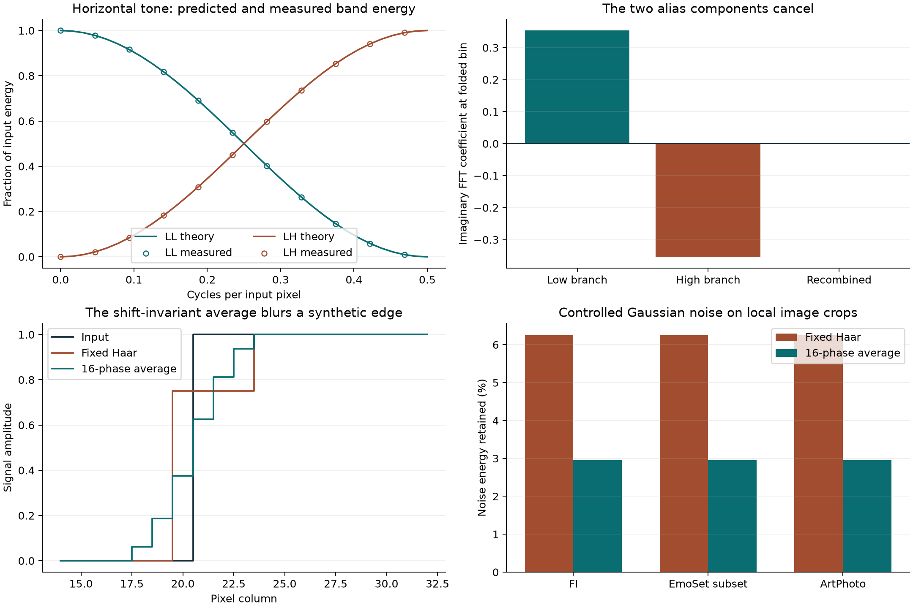

# Experimental checks of the Haar filter bank

These CPU experiments test predictions from the [signal-processing derivations](SIGNAL_PROCESSING.md) against the project's Haar implementation. They run on synthetic signals and existing prepared test crops. The tests measure filter outputs only. The original [recognition study](../../results/wavelet/summary.csv) trained separate classifiers on the fixed Haar grid.

## 1. Tone sweep and directional selectivity

We generated 99 bin-centered complex tones on a $64\times64$ grid. One 33-frequency sweep varied across columns, one across rows and one along both axes. Frequencies ranged from 0 to 0.5 cycles/pixel in steps of $1/64$. The Haar code received the cosine and sine as two real channels. We added their squared energies to make the measurement equivalent to complex-tone energy.

For each tone, the theory predicts the normalized energy of every first-level band. For example, a $1/8$ cycles/pixel diagonal tone gives $C=\cos^2(\pi/8)$ and $S=1-C$. The expected fractions are $C^2=0.728553$, $CS=0.125$ for each of LH and HL, and $S^2=0.021447$ for HH. With frequency along columns only, the row-high bands HL and HH should vanish. We also checked the two-level approximation and the inverse on every input.

| Numerical comparison | Maximum absolute discrepancy |
|---|---:|
| Predicted versus measured first-level subband energy fraction | $1.44\times10^{-15}$ |
| Predicted versus measured two-level approximation energy fraction | $2.62\times10^{-16}$ |
| One-level synthesis versus original pixel value | $2.22\times10^{-16}$ |
| Predicted phase-averaged tone response versus filtered pixel value | $1.28\times10^{-14}$ |

The results support the directional and decimation factors in the derivation. In particular, the squared gain of a filter before decimation and the fraction of total input energy stored in its output band are different quantities.

## 2. A folded FFT bin cancels across the synthesis paths

At twice the sampling interval, tones at $f=1/8$ and $f+1/2=5/8$ cycles per input pixel occupy the same bin at $1/4$ cycles per retained sample. Their even-indexed samples were equal within $2.06\times10^{-14}$.

We supplied the $1/8$-cycles/pixel tone and reconstructed the low-only path, the high-only path and both paths together. The table gives complex FFT coefficients divided by signal length. The folded image's frequency is $5/8$, equivalent to $-3/8$ on the signed input-frequency axis.

| Reconstruction | Coefficient at $+1/8$ | Coefficient at $-3/8$ |
|---|---:|---:|
| Low only | $0.853553$ | $+j\,0.353553$ |
| High only | $0.146447$ | $-j\,0.353553$ |
| Both paths | $1.000000$ | Magnitude $8.10\times10^{-17}$ |

The individual branches carry equal alias magnitudes but opposite phase. The cancellation becomes visible when we add the **complex coefficients**, or equivalently sum the two reconstructions before taking the FFT magnitude.

## 3. A phase-averaged grid becomes an FIR filter

The original two-level approximation uses an anchored 4×4 grid. We circularly shifted the input by each of the 16 grid offsets, applied the original Haar approximation, undid the shift and averaged the outputs. We independently implemented the equivalent separable circular convolution with $h=[1,2,3,4,3,2,1]/16$ on each axis.

- The measured impulse response equaled the predicted 2D kernel to the recorded precision.
- The two-dimensional FFT of the impulse response matched the product of the predicted one-dimensional DTFT responses within $1.33\times10^{-15}$.
- Direct averaging of all 16 shifted reconstructions agreed with the FIR implementation within $2.22\times10^{-16}$ on the numerical cross-check input.

Once equivalence held, we used the separable FIR for the real-crop measurements. On the periodic grid the FIR commutes with integer shifts. This removes dependence on the position of the original block grid.

## 4. Spatial variation and noise on prepared images

The diagnostic sampled up to 24 images per emotion from each existing test manifest, without replacement, using seed 20261121. Images were EXIF-corrected, converted to RGB, bilinearly resized to 192×192, then center-cropped to 160×160 in float64 on the 0–1 scale. FI and EmoSet each supplied 192 crops. ArtPhoto supplied 150 because some classes have fewer than 24 examples. Both operators used the same crops and white-noise draws.

For an operator $A$, shift error is the relative difference between filtering after a one-pixel horizontal circular shift and shifting after filtering:

$$
\frac{\|A(T_1x)-T_1(Ax)\|_2}{\|x-\operatorname{mean}_{\mathrm{channel}}(x)\|_2}.
$$

We computed this per crop and report the mean. Structure and noise measurements are also means of per-crop ratios. Internal gradient energy sums squares of horizontal and vertical first differences and excludes the wrap seam. For noise we used matched independent Gaussian draws with $\sigma=0.03$ and no clipping. By linearity, the noise entering the filtered output is $A\eta$ for injected noise $\eta$, whose energy we report relative to $\|\eta\|^2$.

| Dataset | Crops | One-pixel shift error, fixed → averaged | Noise energy retained, fixed → averaged | Gradient energy retained, fixed → averaged |
|---|---:|---:|---:|---:|
| FI | 192 | 22.74% → 0% | 6.2533% → 2.9559% | 69.26% → 19.24% |
| EmoSet subset | 192 | 24.17% → 0% | 6.2466% → 2.9525% | 75.68% → 19.28% |
| ArtPhoto | 150 | 21.32% → 0% | 6.2507% → 2.9505% | 90.47% → 24.95% |

Across 534 trials the pooled mean noise retentions were 6.2502% and 2.9532%, close to the respective theoretical fractions 6.2500% and 2.9541%. The phase-averaged filter reduces noise and also reduces genuine spatial changes. Fixed Haar can create gradients at the boundaries between its block means, so gradient-energy retention alone cannot measure edge fidelity. The assembled clean-signal relative error was lower with phase averaging on these crops, even though the gradient energy was also lower. These are properties of the filtering operators under the stated boundary rule and dataset sample.



## 5. Recognition remains a separate experimental outcome

The original two-level Haar bank preserves all samples when both branches are synthesized together. Its coarse-only signal attenuates white noise. Neither identity determines how well a classifier can use the two signals. In the matched recognition study, original Haar fusion lost to two RGB towers by 3.023 ECC points on FI and 4.151 on the EmoSet subset. ArtPhoto's uncertainty interval included zero. The two classifiers saw different representations at equal parameter counts. Phase-averaged preprocessing was introduced only for the diagnostics above, so there is no measured recognition score for that modification. [Matched recognition results](../../results/wavelet/summary.csv).

## Reproduce the checks

From the project root with the existing experiment environment and prepared image manifests:

```powershell
python scripts/run_wavelet_sp_checks.py --config local/wavelet.yaml --output runs/haar_checks
```

The script asserts the synthetic identities before measuring photographs. The saved result includes per-frequency values, dataset manifests and hashes, selected row indices, and software versions. Images and weights remain in the local research checkout. [Probe script](../../scripts/run_wavelet_sp_checks.py) · [Measured values](../../results/wavelet/wavelet_sp_results.json).
